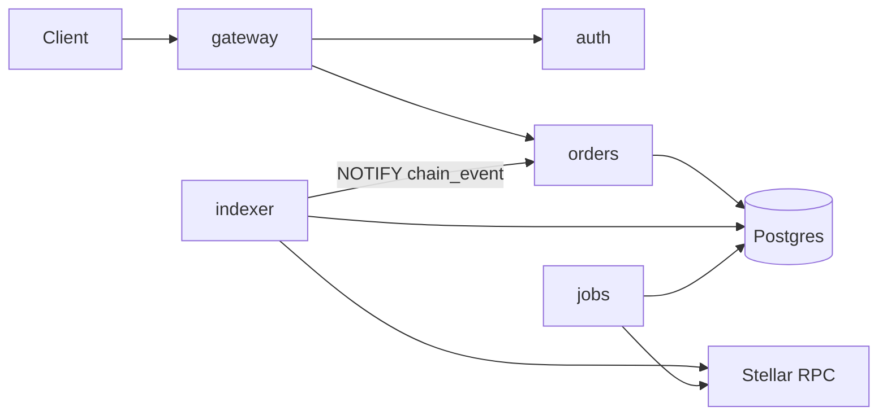
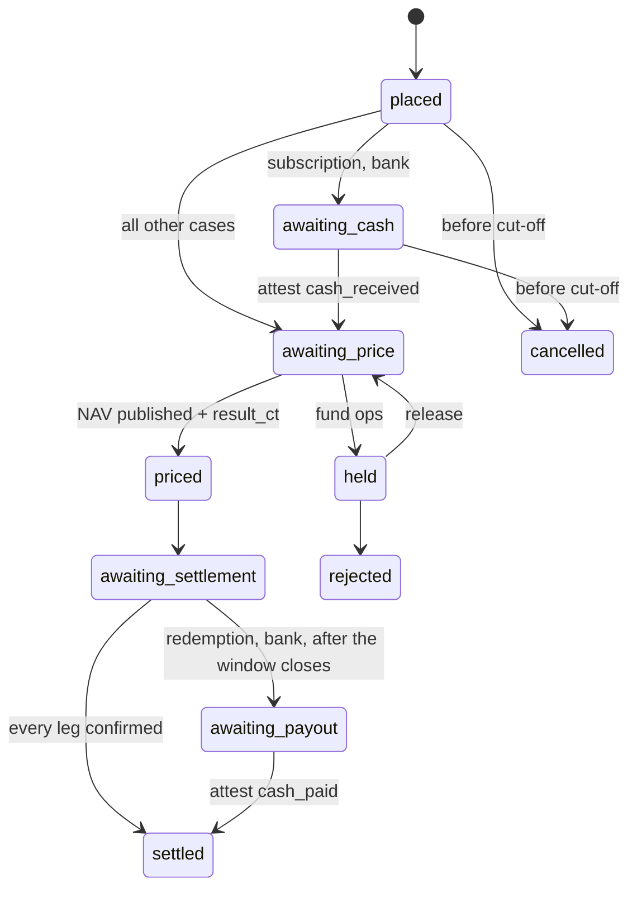

# Cell Seal: Backend

> Repo `cell-seal`. Rust workspace: axum 0.8, sqlx 0.8, tokio, Postgres 16. This is the backend of
> the **sandbox**, the reference tokenization platform: it is not the product and nothing in it is
> sold. It is **amount-blind**: it coordinates orders, stores ciphertext and archives events, but
> holds no key that could read an amount.
>
> For an integrator this document is a worked example. A platform runs its own backend and
> provides the SDK's host services there ([`sdk.md`](sdk.md) section 2.1): section 4.5 and
> section 6 specify the **event archive**, which the `indexer` crate implements and a platform may
> run as is. Sections 4.2 to 4.4 and 5 show one **order store**, which a platform maps onto its own
> order system. Section 1 lists the rules any such backend must keep.

## 1. What the backend may and may not do

| May | May not |
|---|---|
| Know who placed which order, when, and its status | Receive, store, log or return a plaintext amount |
| Store and relay ciphertext, envelopes, partial decryptions | Hold any private key of a user or of a fund |
| Change the state of an on-chain leg when the indexer sees a final event | Change the state of an on-chain leg because a client reported "submitted" |
| Record a signed attestation from fund ops for an off-chain leg | Infer on its own that money has arrived |
| Compute schedules: cut-off, strike, `next_close` | Compute `shares`, `payout`, `net`: these need amounts, so they run on the client |

The only exception: **public** values, meaning NAV, sealed supply (the wrapper balance) and `net`
of a *closed* window, are stored in plaintext because they already sit on chain.

Enforcement: the schema has no numeric column with a monetary meaning other than `nav` and
`windows.net_public`. CI has a test that scans the schema and sample logs to keep it that way.

## 2. Services



| Crate | Process | Responsibility |
|---|---|---|
| `gateway` | `seal-gateway` | REST, authentication, authorization, rate limiting, idempotency |
| `auth` | library | Wallet-signed challenge, sessions, roles |
| `orders` | library inside `seal-gateway` | State machine, dealing calendar, attestations, disclosure requests, DKG relay |
| `indexer` | `seal-indexer` | Archive of events and invocation parameters. Recovery API for wallets |
| `jobs` | `seal-jobs` | On-chain storage TTL extension, reminders, supply reconciliation |
| `core` | library | Types, configuration, RPC client, errors |

`indexer` runs as a separate process so that event archiving is not interrupted when `gateway` is
redeployed.

## 3. Authentication and roles

Login: `POST /auth/challenge {account}` returns a nonce. The client signs it with the wallet
(SEP-0053). `POST /auth/session {account, signature}` returns a JWT. No passwords, no email as an
identifier.

| Role | Scope | Source |
|---|---|---|
| `investor` | Orders and data of that account only | Default after login |
| `fund_ops:viewer` | Read every order of the fund | `fund-registry.grant_role`, synced through the indexer |
| `fund_ops:signer` | Plus: attest, price, close windows | As above |
| `fund_ops:compliance` | Approve and suspend investors | As above |
| `key_holder` | DKG, approve the fund's disclosure requests | The fund's key holder list |
| `reader` | Open one specific disclosure request | Recorded in the request |

Fund roles have their source of truth on chain. The backend only caches them. A fund ops member
whose role is revoked on chain loses API access as soon as the indexer sees the event.

## 4. API

Every write request carries an `Idempotency-Key`. Every error response has the shape
`{ "error": { "code": "ORDER_NOT_FOUND", "message": "order not found" } }`. Fields ending in `_ct` are base64-encoded
sealed boxes. The backend does not interpret their contents.

### 4.1 Public, no login

| Method | Path | Returns |
|---|---|---|
| GET | `/funds` | Fund list: public data from `fund-registry`, latest NAV, fund size, investor count |
| GET | `/funds/{id}` | Public details, NAV history, `net` history of closed windows |
| GET | `/funds/{id}/calendar` | Next cut-off, strike and settlement |

### 4.2 Investor

| Method | Path | Notes |
|---|---|---|
| POST | `/me/box-key` | Register the box public key, with a wallet signature |
| POST | `/me/accounts` | Record a sealed account: wrapper, root form, enrolled signer |
| POST | `/funds/{id}/access-requests` | Ask the fund for approval |
| POST | `/orders` | `{fund_id, order_id, kind, pay, amount_ct_fund, amount_ct_investor}`. `kind` is `sub`, `red` or `pair`. A `pair` order also carries `counterparty` |
| GET | `/orders`, `/orders/{id}` | Metadata plus `amount_ct_investor` plus `result_ct_investor` |
| POST | `/orders/{id}/cancel` | Only before cut-off. For a DvP order the client must `revoke_spender` on chain |
| POST | `/orders/{id}/opening` | `{opening_ct_fund}` for a secondary transfer |

### 4.3 Fund ops

| Method | Path | Notes |
|---|---|---|
| POST | `/funds` | Record a fund just created on chain. The backend checks it against `fund-registry` |
| GET | `/funds/{id}/orders` | Filter by status, kind, period |
| POST | `/orders/{id}/attest` | `{event: cash_received \| cash_paid, signature}` |
| POST | `/orders/{id}/hold`, `/release`, `/reject` | |
| POST | `/orders/{id}/result` | `{result_ct_fund, result_ct_investor}`: shares or payout after strike |
| POST | `/funds/{id}/nav` | Record a NAV just published on chain. The backend checks it against `fund-registry.nav` |
| GET | `/funds/{id}/windows/current` | Window metadata: its orders, `next_close` |
| POST | `/funds/{id}/windows/{n}/plan` | `{plan_ct_fund}`: the window close plan, stored so other fund ops can review it. Sets the window to `closing`. `WindowClosed` sets it to `closed` |
| GET | `/funds/{id}/investors`, PATCH `/investors/{account}` | Approval status, KYC expiry |
| GET | `/funds/{id}/envelopes/mine`, POST `/envelopes` | Envelope of `ops_root`, of `vk`, or of a key share. Also open to `key_holder` |

### 4.4 Key holders and disclosure

| Method | Path | Notes |
|---|---|---|
| POST | `/funds/{id}/dkg` | `fund_ops:signer` starts a ceremony: `{holders, threshold}`. Returns the ceremony id |
| GET | `/funds/{id}/dkg` | Ceremony status: which holders have submitted a share commitment |
| POST, GET | `/dkg/{c}/messages` | Relay encrypted DKG messages (`?since=` on GET). Store public commitments |
| POST | `/funds/{id}/disclosure-requests` | `{reader, scope, from_ledger, to_ledger, expires_at}`. Created by a `fund_ops:signer` or a `key_holder` |
| POST | `/disclosure-requests/{id}/cancel`, `/decline` | Cancel by the requester. Decline by a key holder |
| POST | `/disclosure-requests/{id}/approvals` | `{holder, partials, dleq_proofs, signature}` |
| GET | `/disclosure-requests/{id}/bundle` | For the `reader`: events in scope plus the key holders' partials |
| GET | `/funds/{id}/unlock-log` | Immutable log |

### 4.5 Indexer, serving wallets

Following the API contract in the upstream `docs/indexer.md`:

| Method | Path | Notes |
|---|---|---|
| GET | `/events?contract=&account=&from=&limit=` | Events of one account, in global order |
| GET | `/events/checkpoint?contract=&account=` | Latest checkpoint and its ledger |
| GET | `/invocations/{tx_hash}` | Stored invocation parameters, to retrieve `C_t` |
| GET | `/status` | Ledger ingested so far. The RPC retention floor |

## 5. Order state machine

### 5.1 States



An order placed after cut-off still enters `placed` but is attached to the next dealing day.

### 5.2 The two legs per order kind

| Order | Share leg | Cash leg |
|---|---|---|
| Subscription, bank | `pending` to `confirmed` when the indexer sees `LegSettled(order_id, Share)` at settlement | `pending` to `confirmed` on a `cash_received` attestation |
| Subscription, stablecoin | `confirmed` on `DvpSettled(order_id)` | Same, same event |
| Redemption, bank | `confirmed` on `LegSettled(order_id, Share)`, at order placement | `confirmed` on a `cash_paid` attestation |
| Redemption, stablecoin | `confirmed` on `DvpSettled(order_id)` | Same |
| Secondary transfer | `confirmed` on `PairSettled(order_id)` | Same |

Transition rules:

1. An on-chain leg changes only on an event recorded by the indexer, matched by `order_id`. The
   API has no endpoint for a client to set an on-chain leg to `confirmed`.
2. An off-chain leg changes only on an attestation: a payload `{order_id, event, at}` signed with
   the wallet of a `fund_ops:signer`. The attestation is stored verbatim with its signature.
3. `settled` if and only if both legs are `confirmed`.
4. Every transition writes a row to `audit_log` in the same database transaction.

### 5.3 Dealing calendar

The backend computes it from `FundTerms`: for each dealing day there is a `cutoff_at`, a
`strike_at`, and the window that contains it. At `strike_at` the backend marks the dealing day as
*awaiting NAV* and creates a to-do for fund ops. It publishes nothing itself. An order leaves
`awaiting_price` only when the NAV of that exact dealing day is on chain **and** fund ops have
sent the `result_ct` for that order.

## 6. Indexer

### 6.1 Ingestion

| Topic | Rule |
|---|---|
| Source | Stellar RPC `getEvents` plus `getTransaction`. A Stellar ledger is final when it closes. There are no reorgs |
| Scope | Every event of every `seal-token`, `settlement`, `fund-registry`, `fund-policy`, `seal-auditor`, `seal-verifier` |
| Record | `contract_id`, `ledger_seq`, `ledger_close_time`, `tx_hash`, `tx_application_order`, `event_index`, `topics`, `data`, as raw XDR |
| Invocation parameters | For every transaction that calls `settlement`, also store the XDR of the parameters. `C_t` sits in the leg's `data`, not in the event, and opening verification needs it |
| Ordering | Keep and serve the exact global order `(ledger_seq, tx_application_order, event_index)` |
| Cursor | Table `chain_cursor`. On restart, continue from the cursor. Event writes are idempotent by event id |
| Falling behind | If the cursor drops below the RPC retention floor, events are lost permanently. `seal-jobs` alerts when the gap exceeds 25% of the retention window, and there is a backfill path from Horizon or from an archive node |
| Retention | Permanent. Deleting events destroys investors' ability to recover their wallets |

### 6.2 Projection onto business state

`indexer` emits `NOTIFY chain_event` after each batch. `orders` listens and applies:

| Event | Effect |
|---|---|
| `LegSettled`, `DvpSettled`, `PairSettled` | Change leg state by `order_id` |
| `WindowClosed` | Close the window in the database, record `net_public` and `supply_after`. Open the next window |
| `SetSpender`, `RevokeSpender` | Attach or detach the allowance of that account's pending DvP order |
| `Register` | Mark the investor as having a sealed account in the wrapper |
| `Frozen`, `Unfrozen`, `Clawback` | Update investor status. Create a to-do for compliance |
| `fund-registry`: NAV, roles, terms | Refresh the cache |

### 6.3 Reconciliation

`seal-jobs` runs after every `WindowClosed`: `balance(fund token, share wrapper)` must equal
`supply_after` in the event, and compared with the previous close it may only have changed by
`net` plus the holders' self-wrap `Deposit`s (Case 2). With `net > 0`, the fund token's events must
show the issuer funding exactly `net` into the settlement account right before. With `net < 0`,
retiring exactly `|net|` right after. Any mismatch raises the highest-severity alert
([`integration.md`](integration.md) section 6, T1a to T1c). The old rule
`total_supply = balance(wrapper)` no longer holds once there are public holders. Reconciling the
*sum of sealed claims* against the wrapper balance can only be done on the fund's client, because
it needs amounts.

## 7. Data model

```sql
CREATE TABLE funds (
  fund_id          integer PRIMARY KEY,
  name             text NOT NULL,
  symbol           text NOT NULL,
  currency         text NOT NULL,
  share_token      text NOT NULL,
  share_wrapper    text NOT NULL,
  settlement_acct  text NOT NULL,
  issuer_admin     text NOT NULL,
  auditor_id       integer NOT NULL,
  box_pk           bytea NOT NULL,
  terms            jsonb NOT NULL,
  created_ledger   integer NOT NULL
);

CREATE TABLE users (
  account          text PRIMARY KEY,
  box_pk           bytea,
  box_pk_sig       bytea,
  created_at       timestamptz NOT NULL DEFAULT now()
);

CREATE TABLE sealed_accounts (
  account          text NOT NULL REFERENCES users,
  wrapper          text NOT NULL,
  root_form        text NOT NULL CHECK (root_form IN ('signer','raw','imported')),
  enrolled_signer  text,
  registered_ledger integer,
  PRIMARY KEY (account, wrapper)
);

CREATE TABLE fund_investors (
  fund_id          integer NOT NULL REFERENCES funds,
  account          text NOT NULL REFERENCES users,
  status           text NOT NULL CHECK (status IN ('requested','approved','suspended','removed')),
  kyc_expiry       timestamptz,
  frozen           boolean NOT NULL DEFAULT false,
  profile_ct_fund  bytea,
  PRIMARY KEY (fund_id, account)
);

CREATE TABLE fund_members (
  fund_id          integer NOT NULL REFERENCES funds,
  account          text NOT NULL REFERENCES users,
  role             text NOT NULL,
  granted_ledger   integer NOT NULL,
  revoked_ledger   integer,
  PRIMARY KEY (fund_id, account, role)
);

CREATE TABLE dealing_days (
  fund_id          integer NOT NULL REFERENCES funds,
  dealing_day      integer NOT NULL,
  cutoff_at        timestamptz NOT NULL,
  strike_at        timestamptz NOT NULL,
  window_id        integer NOT NULL,
  nav              numeric(38,7),
  nav_ledger       integer,
  PRIMARY KEY (fund_id, dealing_day)
);

CREATE TABLE windows (
  fund_id          integer NOT NULL REFERENCES funds,
  window_id        integer NOT NULL,
  opens_at         timestamptz NOT NULL,
  closes_at        timestamptz NOT NULL,
  status           text NOT NULL CHECK (status IN ('open','closing','closed')),
  plan_ct_fund     bytea,
  net_public       numeric(38,7),
  supply_after     numeric(38,7),
  closed_ledger    integer,
  PRIMARY KEY (fund_id, window_id)
);

CREATE TABLE orders (
  order_id           bytea PRIMARY KEY,
  reference          text NOT NULL UNIQUE,
  fund_id            integer NOT NULL REFERENCES funds,
  investor           text NOT NULL REFERENCES users,
  counterparty       text REFERENCES users,
  kind               text NOT NULL CHECK (kind IN ('sub','red','pair')),
  pay                text NOT NULL,
  dealing_day        integer NOT NULL,
  window_id          integer NOT NULL,
  status             text NOT NULL,
  share_leg          text NOT NULL CHECK (share_leg IN ('pending','delivered','confirmed')),
  cash_leg           text NOT NULL CHECK (cash_leg IN ('pending','delivered','confirmed')),
  amount_ct_fund     bytea NOT NULL,
  amount_ct_investor bytea NOT NULL,
  result_ct_fund     bytea,
  result_ct_investor bytea,
  opening_ct_fund    bytea,
  placed_at          timestamptz NOT NULL DEFAULT now(),
  settled_at         timestamptz
);

CREATE INDEX orders_fund_status ON orders (fund_id, status, dealing_day);
CREATE INDEX orders_investor ON orders (investor, placed_at DESC);

CREATE TABLE attestations (
  id               bigserial PRIMARY KEY,
  order_id         bytea NOT NULL REFERENCES orders,
  event            text NOT NULL CHECK (event IN ('cash_received','cash_paid')),
  signer           text NOT NULL,
  payload          bytea NOT NULL,
  signature        bytea NOT NULL,
  created_at       timestamptz NOT NULL DEFAULT now(),
  UNIQUE (order_id, event)
);

CREATE TABLE key_envelopes (
  fund_id          integer NOT NULL REFERENCES funds,
  recipient        text NOT NULL REFERENCES users,
  kind             text NOT NULL CHECK (kind IN ('ops_root','vk','key_share')),
  epoch            integer NOT NULL DEFAULT 0,
  envelope         bytea NOT NULL,
  created_by       text NOT NULL,
  created_at       timestamptz NOT NULL DEFAULT now(),
  PRIMARY KEY (fund_id, recipient, kind, epoch)
);

CREATE TABLE viewing_key_epochs (
  fund_id          integer NOT NULL REFERENCES funds,
  epoch            integer NOT NULL,
  threshold        integer NOT NULL,
  holders          jsonb NOT NULL,
  public_key       bytea NOT NULL,
  share_commitments jsonb NOT NULL,
  from_ledger      integer NOT NULL,
  to_ledger        integer,
  PRIMARY KEY (fund_id, epoch)
);

CREATE TABLE disclosure_requests (
  id               uuid PRIMARY KEY,
  fund_id          integer NOT NULL REFERENCES funds,
  reader           text NOT NULL,
  scope            jsonb NOT NULL,
  from_ledger      integer NOT NULL,
  to_ledger        integer NOT NULL,
  expires_at       timestamptz NOT NULL,
  status           text NOT NULL CHECK (status IN ('pending','open','expired','declined','cancelled')),
  requested_by     text NOT NULL,
  created_at       timestamptz NOT NULL DEFAULT now()
);

CREATE TABLE disclosure_approvals (
  request_id       uuid NOT NULL REFERENCES disclosure_requests,
  holder           text NOT NULL,
  epoch            integer NOT NULL,
  partials         bytea NOT NULL,
  signature        bytea NOT NULL,
  created_at       timestamptz NOT NULL DEFAULT now(),
  PRIMARY KEY (request_id, holder, epoch)
);

CREATE TABLE chain_events (
  contract_id          text NOT NULL,
  ledger_seq           integer NOT NULL,
  tx_application_order integer NOT NULL,
  event_index          integer NOT NULL,
  ledger_close_time    timestamptz NOT NULL,
  tx_hash              bytea NOT NULL,
  topics               bytea NOT NULL,
  data                 bytea NOT NULL,
  accounts             text[] NOT NULL,
  PRIMARY KEY (ledger_seq, tx_application_order, event_index)
);

CREATE INDEX chain_events_account ON chain_events USING gin (accounts);
CREATE INDEX chain_events_contract ON chain_events (contract_id, ledger_seq);

CREATE TABLE chain_invocations (
  tx_hash          bytea PRIMARY KEY,
  ledger_seq       integer NOT NULL,
  contract_id      text NOT NULL,
  function         text NOT NULL,
  args             bytea NOT NULL
);

CREATE TABLE chain_cursor (
  id               boolean PRIMARY KEY DEFAULT true CHECK (id),
  ledger_seq       integer NOT NULL,
  updated_at       timestamptz NOT NULL DEFAULT now()
);

CREATE TABLE audit_log (
  id               bigserial PRIMARY KEY,
  fund_id          integer,
  actor            text NOT NULL,
  action           text NOT NULL,
  subject          text NOT NULL,
  detail           jsonb NOT NULL,
  prev_hash        bytea,
  hash             bytea NOT NULL,
  created_at       timestamptz NOT NULL DEFAULT now()
);
```

Schema notes:

| Where | Why |
|---|---|
| `orders.pay` is free text (`bank`, `cash:<wrapper>`) | Adding a new stablecoin needs no migration |
| `fund_investors.profile_ct_fund` | The investor's legal name and bank details are data the fund needs and the backend does not, so they are a sealed box too |
| `chain_events.accounts` | Every address that appears in the topics, so account queries do not have to decode XDR at read time |
| `audit_log.prev_hash`, `hash` | Hash chain. Editing an old row breaks the chain from that row onward. The unlock log is a filtered view over this table |
| No `balances` or `register` table | The register needs amounts, so it exists only on the fund's client |

## 8. Operations

| Topic | Rule |
|---|---|
| Configuration | Environment variables: `DATABASE_URL`, `STELLAR_RPC_URL`, `NETWORK_PASSPHRASE`, `REGISTRY_CONTRACT`, `SETTLEMENT_CONTRACT`, `JWT_SECRET`, `CORS_ORIGINS` |
| Logging | Structured JSON. `_ct` fields are never logged, not even at debug level. Middleware strips request bodies before writing |
| Metrics | Indexer lag (ledgers), orders by status, age of the oldest order in `awaiting_cash`, attestations per day, error rate by code |
| Alerts | Indexer lag over threshold. Supply reconciliation mismatch. Window past `closes_at` and not closed. On-chain verification key changed |
| Backup | Postgres PITR. Data that cannot be rebuilt from chain: ciphertext, attestations, envelopes, `audit_log`. `chain_events` can be rebuilt as long as the RPC or an archive node still holds the events |
| Running a copy | Same image, same compose file. A platform that runs its own copy of the sandbox keeps its own metadata. Features are identical |
| TTL job | Daily, extend the TTL of the `ConfidentialAccount` and `SpenderDelegation` entries of every account active in the last 90 days. The platform pays the fee and prices it into its service fee |
