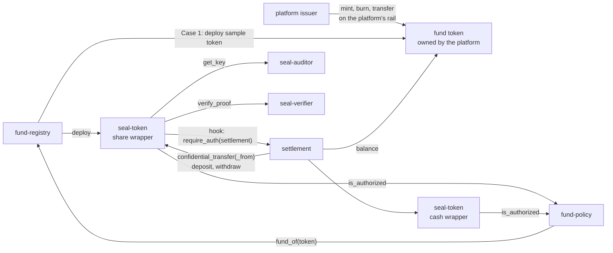

# Cell Seal: Contracts

> Repo `cell-seal-contracts`. Rust, Soroban SDK, one workspace crate per contract.
> The OpenZeppelin parts follow branch `v0.9.0` of `OpenZeppelin/stellar-contracts`, pinned by commit.
> Primitive signatures in this doc are copied from `packages/tokens/src/confidential/docs/protocol/interface.md`.

## 1. Map



Shared conventions: share and stablecoin amounts are `i128` with 7 decimal places. NAV is an `i128`
at scale `10^7` (1.0427 = `10_427_000`). Cell Seal error codes start at `4000`, separate from the
OpenZeppelin ranges `3500` (token) and `3600` (compliance).

## 2. Fund token

The fund's SEP-41 token, **owned by the platform**: the SAC of a classic asset, or a custom Soroban
token. Cell Seal does not mint, does not burn, and holds no admin role on it. The conditions the
token must meet (decimals, `AUTH_REQUIRED`, clawback, SEP-8): [`integration.md`](integration.md) section 3.

| Token function Cell Seal calls | Caller | Note |
|---|---|---|
| `transfer(from, to, amount)` | Share wrapper, inside `deposit` and `withdraw` | The wrapper is one public holder of the token and holds the pool backing every sealed balance |
| `balance(account)` | `settlement` | Checks that the settlement account has been funded with `net` before wrapping. Reads `supply_after` |

The platform issuer mints and burns on its own rail: it funds `net` into the settlement account before
`close_window` when `net > 0`, and retires `|net|` after `close_window` when `net < 0`.

The current prototype ships `share-token` (OpenZeppelin fungible, `mint(to, amount, operator)` for the
issuer role, `burn` by the holder) as a **sample token** for tests and for Case 1 demos. It is not part
of the product.

Invariant **T1**: `balance(token, share wrapper)` changes only at `close_window` (by exactly `net`) and
at a holder's self-wrap `deposit` (section 3.3). After every `close_window` it equals `supply_after`. Full
reconciliation: [`integration.md`](integration.md) section 6.

## 3. `seal-token`

Concrete contract implementing the OpenZeppelin traits `ConfidentialToken` + `ConfidentialCompliance`
+ `ConfidentialClawback`. Two configurations: **share wrapper** (one per fund) and **cash wrapper**
(one per stablecoin, shared across the platform).

### 3.1 Surface taken verbatim from the primitive

```rust
fn register(e: Env, account: Address, auditor_id: u32, data: Bytes);
fn deposit(e: Env, from: Address, to: Address, amount: i128);
fn merge(e: Env, account: Address);
fn withdraw(e: Env, from: Address, to: Address, amount: i128, data: Bytes);
fn confidential_transfer(e: Env, from: Address, to: Address, data: Bytes);
fn confidential_transfer_from(e: Env, spender: Address, from: Address, to: Address, data: Bytes);
fn set_spender(e: Env, account: Address, spender: Address, live_until_ledger: u32, data: Bytes);
fn revoke_spender(e: Env, account: Address, spender: Address);
fn confidential_balance(e: Env, account: Address) -> ConfidentialAccount;
fn is_spender(e: Env, account: Address, spender: Address) -> bool;
fn get_spender_delegation(e: Env, account: Address, spender: Address) -> SpenderDelegation;

fn freeze(e: Env, account: Address, operator: Address);
fn unfreeze(e: Env, account: Address, operator: Address);
fn set_compliance_config(e: Env, config: ComplianceConfig, operator: Address);
fn clawback(e: Env, account: Address, amount: i128, destination: Option<Address>, data: Bytes, operator: Address);
fn force_revoke_spender(e: Env, account: Address, spender: Address, operator: Address);
```

`require_auth` for each function follows the table in the primitive's spec: `from` for transfers,
`spender` (not `from`) for `confidential_transfer_from`, `account` for `register`, `set_spender`,
`revoke_spender`, `merge`.

Two storage structs. Every Grumpkin point is 64 bytes:

```rust
ConfidentialAccount { spending_public_key, viewing_public_key, spendable_commitment, receiving_commitment, auditor_id }
SpenderDelegation   { allowance_commitment, a_tilde, escrowed_dvk, allowance_salt, live_until_ledger }
```

### 3.2 Cell Seal constructor

```rust
fn __constructor(
    e: Env,
    admin: Address,
    token: Address,
    verifier: Address,
    auditor: Address,
    compliance: Option<ComplianceConfig>,
    seal: SealConfig,
);

struct SealConfig {
    settlement: Address,
    registry: Address,
    kind: WrapperKind,
    fund_id: Option<u32>,
}

enum WrapperKind { Share, Cash }
```

| Argument | Share wrapper | Cash wrapper |
|---|---|---|
| `admin` | The fund's issuer admin | The platform admin |
| `token` | The fund token | The stablecoin |
| `compliance` | `{ policy: fund-policy, sac_passthrough: false }` | `{ policy: fund-policy, sac_passthrough: true }` when the stablecoin is a SAC, so that freeze orders from the stablecoin issuer are honoured |
| `seal.kind`, `seal.fund_id` | `Share`, `Some(fund_id)` | `Cash`, `None` |

`seal.registry` is the `fund-registry` address. The hooks read fund data from it: a share wrapper
calls `fund(fund_id)` for the fund's `auditor_id` and settlement account, a cash wrapper calls
`is_settlement_account(account)` and `is_fund_auditor_id(auditor_id)`. The wrapper caches nothing,
so a change in the registry applies on the next call.

### 3.3 `SealHooks`

The primitive offers a single extension point: the `Hooks` trait, invoked after authentication and
payload decryption, before storage is written. `SealHooks` runs Cell Seal's rules and then delegates to
`ComplianceHooks` (freeze, policy, SAC). A hook never receives the amount of a transfer.

| Hook | Share wrapper | Cash wrapper | Reason |
|---|---|---|---|
| `on_register` | `auditor_id` must equal the fund's `auditor_id` | `is_fund_auditor_id(auditor_id)` must be true | The investor picks `auditor_id` and cannot change it. Without this rule the fund is blind to that investor |
| `on_deposit` | `from == to`, and `to` passes policy. The settlement account wraps the net through `settlement`. A Case 2 public holder self-wraps its own balance | `from == to` | A deposit carries a public amount together with the recipient address. Nobody may deposit on someone else's behalf. A self-wrapped amount was already public |
| `on_withdraw` | Settlement account only, and called from `settlement` | `from == to` | Investors do not unwrap shares. Shares leave the wrapper only as the net of a window |
| `on_transfer` | `settlement.require_auth()` | `settlement.require_auth()` | Every transfer goes through `settlement` to carry an order reference, and so the settlement account cannot pull an allowance outside DvP |
| `on_spender_transfer` | as above | as above | |
| `on_set_spender` | `spender` must be the fund's settlement account | `spender` must be the settlement account of some fund | Blocks arbitrary delegation |
| `on_merge`, `on_revoke_spender` | no extra rule | no extra rule | An investor can always take an allowance back |

`settlement.require_auth()` inside a hook succeeds when `settlement` is the contract calling directly
into `seal-token`, and a direct call to the wrapper is rejected even when the sender signed. This was
confirmed on testnet, so no extra flag is needed.

### 3.4 Additional errors

| Code | Name | When |
|---|---|---|
| 4000 | `AuditorNotApproved` | `register` with an `auditor_id` outside the allowed set |
| 4001 | `DepositNotAllowed` | `on_deposit` rule violated |
| 4002 | `WithdrawNotAllowed` | `on_withdraw` rule violated |
| 4003 | `NotViaSettlement` | Transfer not routed through `settlement` |
| 4004 | `SpenderNotAllowed` | `set_spender` to an address that is not a settlement account |

## 4. `seal-verifier` and `seal-auditor`

The primitive's traits, plus access control.

```rust
fn verify_proof(e: &Env, circuit_type: CircuitType, public_inputs: Bytes, proof: Bytes);
fn register_verification_key(e: &Env, circuit_type: CircuitType, vk: Bytes, operator: Address);
fn update_verification_key(e: &Env, circuit_type: CircuitType, vk: Bytes, operator: Address);

enum CircuitType { Register = 0, Withdraw = 1, Transfer = 2, SpenderTransfer = 3, SetSpender = 4, Clawback = 100 }
```

```rust
fn register_key(e: &Env, auditor_id: u32, point: BytesN<64>, operator: Address);
fn rotate_key(e: &Env, auditor_id: u32, new_point: BytesN<64>, operator: Address);
fn get_key(e: &Env, auditor_id: u32) -> BytesN<64>;
```

| Rule | Content |
|---|---|
| Who writes verification keys | `operator` is the platform admin (multisig). `register_verification_key` works once per `circuit_type`. `update_verification_key` is two calls by the same operator: the first stores the proposal with the current ledger, the second applies it once `timelock_ledgers` have passed. `timelock_ledgers` is a constructor argument, default 17280 (about 24 hours) |
| Who writes auditor keys | `register_key`: `operator` must be the `fund-registry` contract, which calls it inside `create_fund`. `rotate_key`: `operator` must be the issuer admin of the fund that owns that `auditor_id`, read from `fund-registry.fund_of_auditor(auditor_id)` |
| Effect of `rotate_key` | In-flight proofs revert. Readability only applies going forward, so key holders must keep old key shares to read history |
| `CircuitType` is fixed | The primitive's trait fixes the enum. Any new Cell Seal circuit needs its own verifier. This enum is not extended |

| Code | Name | When |
|---|---|---|
| 4200 | `NotPlatformAdmin` | `seal-verifier`: `operator` is not the platform admin |
| 4201 | `KeyAlreadyRegistered` | `register_verification_key` for a `circuit_type` that has a key |
| 4202 | `TimelockPending` | The second `update_verification_key` call comes before `timelock_ledgers` have passed |
| 4203 | `NoPendingUpdate` | The second call has no stored proposal, or the proposal differs from the stored one |
| 4300 | `AuditorIdTaken` | `register_key` for an `auditor_id` that exists |
| 4301 | `NotKeyOwner` | `rotate_key` by an operator who is not that fund's issuer admin |
| 4302 | `UnknownAuditorId` | `get_key` or `rotate_key` for an unknown id |

## 5. `fund-policy`

Implements the single interface the primitive calls:

```rust
fn is_authorized(e: Env, account: Address, token: Address) -> bool;
```

Called for both `from` and `to` on every operation. The policy only sees an address and a token.

```rust
fn set_investor(e: Env, fund_id: u32, account: Address, status: InvestorStatus, kyc_expiry: u64, operator: Address);
fn investor(e: Env, fund_id: u32, account: Address) -> Option<InvestorEntry>;

enum InvestorStatus { Approved, Suspended, Removed }
struct InvestorEntry { status: InvestorStatus, kyc_expiry: u64, updated_ledger: u32 }
```

The policy tells the two wrapper kinds apart through the registry: `fund_of(token)` returns
`Some(f)` for the share wrapper of fund `f` and `None` for a cash wrapper.

| Token | `is_authorized` returns `true` when |
|---|---|
| Share wrapper of fund `f` | `account` is the settlement account of `f`, **or** `investor(f, account)` is `Approved` and `kyc_expiry` has not passed |
| Cash wrapper | `account` is the settlement account of some fund, **or** `account` is `Approved` with a valid `kyc_expiry` in at least one fund |

`kyc_expiry` is a Unix timestamp compared with `ledger.timestamp()`. A `Suspended` or `Removed`
investor fails the check at once, so a pending transfer to or from that account reverts.

`set_investor` requires `operator.require_auth()` and `fund-registry.has_role(fund_id, operator,
Compliance)`. The issuer admin grants that role. The KYC source is the issuer, who attests
`kyc_expiry` from its own KYC process. An external attestation provider plugs in behind the same
`set_investor` call without a contract change.

| Code | Name | When |
|---|---|---|
| 4400 | `NotCompliance` | `set_investor` by an operator without the `Compliance` role on that fund |
| 4401 | `UnknownFund` | `fund_id` not in the registry |

Event `InvestorSet { fund_id, account, status, kyc_expiry }`. The policy stores one `InvestorEntry`
per `(fund_id, account)` in persistent storage. A `Removed` entry stays, so the history of an
account is readable from chain.

## 6. `settlement`

The single gate for every sealed movement. Holds no assets, holds no keys, sees no amount, except the
window's `net`, which is public by design. Does not mint and does not burn the fund token.

### 6.1 Types

```rust
struct Leg {
    token: Address,
    kind: LegKind,
    from: Address,
    to: Address,
    data: Bytes,
}

enum LegKind { Direct, Spender }

enum LegRole { Share, Cash }

struct WindowState {
    window_id: u32,
    period_secs: u64,
    next_close: u64,
}
```

`order_id: BytesN<32>` is `SHA-256(fund_id || investor || client_nonce)`, generated on the client. It is
the only part of an order that appears publicly.

Storage, all persistent:

| Key | Value | Written by |
|---|---|---|
| `Fund(fund_id)` | `FundLink { share_wrapper, token, settlement_account, issuer_admin }` | `register_fund` |
| `Window(fund_id)` | `WindowState` | `register_fund`, `close_window` |
| `PilotCap(fund_id)` | `i128`, sealed supply the fund may not exceed | `register_fund` (default from the constructor), `set_pilot_cap` |
| `Settled(order_id, role)` | `()` | `submit_leg`, `settle_dvp`, `settle_pair` |
| `Admin` | The platform admin address | Constructor |
| `Registry` | The `fund-registry` address | Constructor |

Cash wrappers are not stored here. "Both tokens in the fund" means: the share wrapper of `fund_id`,
plus any address in `fund-registry.fund(fund_id).terms.cash_wrappers`.

### 6.2 Functions

```rust
fn register_fund(e: Env, fund_id: u32, share_wrapper: Address, token: Address, settlement_account: Address, issuer_admin: Address, period_secs: u64, first_close: u64);
fn set_pilot_cap(e: Env, fund_id: u32, cap: i128, operator: Address);
fn submit_leg(e: Env, fund_id: u32, order_id: BytesN<32>, role: LegRole, leg: Leg);
fn settle_dvp(e: Env, fund_id: u32, order_id: BytesN<32>, pull: Leg, pay: Leg);
fn settle_pair(e: Env, fund_id: u32, order_id: BytesN<32>, a: Leg, b: Leg);
fn close_window(e: Env, fund_id: u32, window_id: u32, net: i128, withdraw_data: Option<Bytes>);
fn window(e: Env, fund_id: u32) -> WindowState;
fn leg_settled(e: Env, order_id: BytesN<32>, role: LegRole) -> bool;
```

| Function | Signer | Checks | Execution |
|---|---|---|---|
| `register_fund` | The `fund-registry` contract (`Registry.require_auth()`) | `fund_id` not yet registered | Writes `FundLink`, `WindowState { window_id: 1, period_secs, next_close: first_close }`, the default pilot cap. Emits `FundRegistered` |
| `set_pilot_cap` | Platform admin | | Writes `PilotCap`. Emits `PilotCapSet` |
| `submit_leg` | `leg.from` | `leg.kind == Direct`. `leg.token` belongs to the fund. `(order_id, role)` not yet settled. One end of the leg is the settlement account | Calls `confidential_transfer`. Records `(order_id, role)` |
| `settle_dvp` | Settlement account | `pull.kind == Spender`, `pay.kind == Direct`. Two different tokens, both in the fund. `pull.to == pay.from ==` settlement account. `pull.from == pay.to`. Neither role settled yet | `confidential_transfer_from` then `confidential_transfer`, same invocation |
| `settle_pair` | `a.from` and `b.from`, one authorization entry each | Two different tokens, both in the fund. `a.from == b.to`, `a.to == b.from`. Neither side is the settlement account | Two `confidential_transfer`s, same invocation |
| `close_window` | Issuer admin **and** settlement account | `window_id` is the current window. `ledger.timestamp() >= next_close`. If `net > 0` then `balance(token, settlement account) >= net`. If `net < 0` then `withdraw_data` must be present. If `net = 0`, neither check applies. `balance(token, share wrapper) + net <= PilotCap` | `net > 0`: `deposit(from = to = settlement account, net)`. `net < 0`: `withdraw(from = to = settlement account, \|net\|, withdraw_data)`. `net = 0`: no token moves, same signers, the window still advances and emits `WindowClosed`. No `mint`, no `burn`. Increments `window_id`. Re-reads `window_period_secs` from the registry into `period_secs` and sets `next_close = next_close + period_secs`. Emits `WindowClosed` |

The settlement account signs for `deposit` and `withdraw`. The issuer admin signs to approve the net
figure that is about to become public. Funding `net` public tokens into the settlement account before
closing (`net > 0`) and retiring `|net|` after closing (`net < 0`) is the issuer's job on the platform's
rail, [`integration.md`](integration.md) section 4. The interval during which public tokens sit in the
settlement account between those two steps should be short. The SDK merges them into one operational
step. The contract checks `balance >= net` so that a stray dust transfer cannot block a close. The SDK is
stricter by design and closes only when the balance equals `net` (`E_NET_NOT_FUNDED`, `E_NET_OVERFUNDED`,
[`sdk.md`](sdk.md) section 4.4), because a surplus is a leak (L16).

`close_window` refuses to run before `next_close`. This is the on-chain enforcement of the anti-leak
rule "unwrap on a schedule, not per order": the issuer cannot unwrap right after a large redemption
even if it wants to.

Two UltraHonk proofs in one invocation (`settle_dvp`, `settle_pair`) fit in one Soroban
transaction: two transfer proofs measured on testnet at about 188 M instructions against the 400 M
ceiling ([`primitives.md`](primitives.md) section 8).

### 6.3 Events

| Event | Fields | Note |
|---|---|---|
| `FundRegistered` | `fund_id`, `share_wrapper`, `token`, `settlement_account` | Once per fund |
| `PilotCapSet` | `fund_id`, `cap` | |
| `LegSettled` | `fund_id`, `order_id`, `role`, `token`, `from`, `to` | No amount |
| `DvpSettled` | `fund_id`, `order_id`, `investor` | `investor` is `pull.from` |
| `PairSettled` | `fund_id`, `order_id`, `a`, `b` | `a` is `a.from`, `b` is `b.from` |
| `WindowClosed` | `fund_id`, `window_id`, `net`, `supply_after`, `next_close` | `net` is the window's only public figure. `supply_after` is `balance(token, wrapper)`, that is sealed supply, not `total_supply` |

The primitive's own events (`Transfer`, `SpenderTransfer`, `Deposit`, `Withdraw` and the rest) are still
emitted by `seal-token` and carry the ciphertexts for the recipient and for the auditor.

### 6.4 Errors

| Code | Name |
|---|---|
| 4100 | `UnknownFund` |
| 4101 | `TokenNotInFund` |
| 4102 | `LegAlreadySettled` |
| 4103 | `LegShapeInvalid` |
| 4104 | `WindowNotDue` |
| 4105 | `WindowIdMismatch` |
| 4106 | `WithdrawDataMissing` |
| 4107 | `PilotCapExceeded` |
| 4108 | `NetNotFunded` |
| 4109 | `FundAlreadyRegistered` |
| 4110 | `NotRegistry` |
| 4111 | `NotPlatformAdmin` |

`4103 LegShapeInvalid` covers every shape rule in the table above: wrong `kind`, wrong direction,
same token on both legs, a settlement account where an investor is required or the reverse.

## 7. `fund-registry`

```rust
fn create_fund(e: Env, params: FundParams, token: Option<Address>, issuer_admin: Address, settlement_account: Address, auditor_key: BytesN<64>) -> u32;
fn fund(e: Env, fund_id: u32) -> FundInfo;
fn funds(e: Env, start: u32, limit: u32) -> Vec<FundInfo>;
fn fund_of(e: Env, token: Address) -> Option<u32>;
fn fund_of_auditor(e: Env, auditor_id: u32) -> Option<u32>;
fn is_fund_auditor_id(e: Env, auditor_id: u32) -> bool;
fn is_settlement_account(e: Env, account: Address) -> bool;
fn has_role(e: Env, fund_id: u32, account: Address, role: FundRole) -> bool;
fn publish_nav(e: Env, fund_id: u32, dealing_day: u32, nav: i128, operator: Address);
fn nav(e: Env, fund_id: u32, dealing_day: u32) -> Option<i128>;
fn update_terms(e: Env, fund_id: u32, terms: FundTerms, operator: Address);
fn grant_role(e: Env, fund_id: u32, account: Address, role: FundRole, operator: Address);
fn revoke_role(e: Env, fund_id: u32, account: Address, role: FundRole, operator: Address);

struct FundParams { name: String, symbol: String, currency: Symbol, manager: String, terms: FundTerms }
struct FundTerms  { dealing: Dealing, cutoff_secs_before: u64, window_period_secs: u64, sub_fee_bps: u32, red_fee_bps: u32, min_investment: i128, pay_bank: bool, cash_wrappers: Vec<Address>, docs_hash: BytesN<32> }
struct FundInfo   { fund_id: u32, params: FundParams, token: Address, share_wrapper: Address, settlement_account: Address, issuer_admin: Address, auditor_id: u32, box_pk: BytesN<32>, created_ledger: u32 }
enum Dealing  { Daily, Weekly, Monthly }
enum FundRole { Ops, Compliance, NavPublisher }
```

`create_fund` requires `issuer_admin.require_auth()` and runs in one invocation:

1. `token = Some(address)`: uses the platform's token (Case 1 and Case 2 in production).
   `token = None`: deploys the sample `share-token` with `issuer_admin` as minter. The sandbox uses
   this form so a platform can try the rail without preparing a token.
2. Deploys the share wrapper through the Soroban deployer with the pinned wasm hash, `admin =
   issuer_admin`, `token`, the platform's verifier, auditor and policy, `seal.fund_id = fund_id`.
3. Allocates `auditor_id = fund_id` and calls `seal-auditor.register_key(auditor_id, auditor_key)`.
4. Calls `settlement.register_fund(fund_id, share_wrapper, token, settlement_account, issuer_admin,
   terms.window_period_secs, first_close)`, with `first_close = ledger.timestamp() +
   window_period_secs`.
5. Stores `FundInfo`, grants `issuer_admin` every `FundRole`, and returns `fund_id`.

`dealing_day` is the number of days since 1970-01-01 (UTC). `publish_nav` requires the
`NavPublisher` role, refuses a second NAV for the same `dealing_day` and emits `NavPublished`.
`update_terms`, `grant_role` and `revoke_role` require `operator` to be the fund's issuer admin.
`update_terms` cannot change `window_period_secs` of the window in progress: the new value applies
from the next `close_window`, which reads it from the registry.

`publish_nav` puts the NAV on chain: investors read the price from the chain, not from the backend,
and the NAV has a ledger anchor for dispute resolution. Every field of `FundInfo` is public and is the
data source for any fund list a platform shows, the sandbox investor app included.

Storage, all persistent: `Fund(fund_id)`, `TokenIndex(token) -> fund_id`,
`AuditorIndex(auditor_id) -> fund_id`, `SettlementIndex(account) -> fund_id`,
`Role(fund_id, account, role)`, `Nav(fund_id, dealing_day)`, `NextFundId`.

| Event | Fields |
|---|---|
| `FundCreated` | `fund_id`, `token`, `share_wrapper`, `settlement_account`, `issuer_admin`, `auditor_id` |
| `NavPublished` | `fund_id`, `dealing_day`, `nav` |
| `TermsUpdated` | `fund_id` |
| `RoleGranted`, `RoleRevoked` | `fund_id`, `account`, `role` |

| Code | Name | When |
|---|---|---|
| 4500 | `UnknownFund` | |
| 4501 | `NotIssuerAdmin` | `update_terms`, `grant_role`, `revoke_role` by someone else |
| 4502 | `RoleMissing` | `publish_nav` without `NavPublisher` |
| 4503 | `NavAlreadyPublished` | Second NAV for the same `dealing_day` |
| 4504 | `TokenAlreadyWrapped` | `create_fund` with a `token` that already has a fund |
| 4505 | `SettlementAccountInUse` | `create_fund` with a `settlement_account` that belongs to another fund |

## 8. Permission matrix

| Operation | Platform admin | Issuer admin | Settlement account | Fund ops | Investor |
|---|---|---|---|---|---|
| Deploy, upgrade platform contracts | yes, multisig + timelock | | | | |
| Write verification keys | yes | | | | |
| `create_fund`, `update_terms`, `grant_role`, `revoke_role` | | yes | | | |
| `register_fund` in `settlement`, `register_key` in `seal-auditor` | | | | | called by `fund-registry` inside `create_fund` |
| `set_pilot_cap` | yes | | | | |
| `rotate_key` for the fund | | yes | | | |
| `freeze`, `clawback` | | yes | | | |
| `close_window` | | co-signs | co-signs | | |
| Mint, burn the fund token | | yes, on the platform's rail, outside Cell Seal | | | |
| `settle_dvp`, deliver subscription shares | | | yes | operator | |
| `set_investor`, `publish_nav` | | | | yes, by role | |
| `register`, `submit_leg`, `set_spender`, `revoke_spender`, `merge` | | | | | yes |
| `settle_pair` | | | | | yes, both sides |

## 9. Invariants

| # | Invariant | Enforced by |
|---|---|---|
| T1 | `balance(token, share wrapper)` changes only at `close_window`, by exactly `net`, and at a holder's self-wrap `deposit`. After every `close_window` it equals `supply_after` | `settlement`, `on_deposit`, `on_withdraw`. Indexer |
| T2 | The sum of sealed claims inside the wrapper equals the underlying token balance the wrapper holds | The primitive's conservation proof. Indexer reconciliation |
| C1 | No sealed transfer happens outside `settlement` | `SealHooks` |
| C2 | Every sealed transfer is bound to exactly one `(order_id, role)`, and each such pair settles at most once | `settlement` |
| C3 | The window's net enters or leaves the wrapper only at `close_window`, never before `next_close`. The issuer funds exactly `net` before and retires exactly `\|net\|` after, on the platform's rail | `settlement`. Indexer reconciliation T1c in [`integration.md`](integration.md) section 6 |
| C4 | Every account in the share wrapper of fund `f` carries the `auditor_id` of `f` | `on_register` |
| C5 | An allowance can only be granted to a settlement account | `on_set_spender` |
| C6 | No Cell Seal contract receives a plaintext amount, except the `net` of `close_window` | Review + tests |

## 10. Operations

| Topic | Rule |
|---|---|
| Storage TTL | `ConfidentialAccount` and `SpenderDelegation` entries are persistent. A host job (sandbox: `seal-jobs`) extends the TTL of every active account. An expired entry can still be restored but costs a restore fee |
| Upgrade | `settlement`, `fund-policy`, `fund-registry`: platform admin, timelock. A fund's `seal-token`: that fund's issuer admin. The wrapper address is an input of every investor's key derivation (`addr_f` in [`keys.md`](keys.md) section 2.1), so a wrapper is upgraded in place and never redeployed |
| Pilot cap | `settlement` keeps a per-fund `PilotCap`. `close_window` refuses when the sealed supply after the close would exceed it (`4107`). Lifting the cap is `set_pilot_cap` by the platform admin, after audit |
| Pooled custody risk | The wrapper holds the underlying token for every holder. A SAC issuer that freezes or claws back the wrapper address affects every holder. For the fund token the issuer is the platform or a fund on the platform: the onboarding checklist in [`integration.md`](integration.md) section 3 requires a commitment not to claw back the wrapper. For stablecoins this is a third-party risk and must be stated in the fund-facing documentation |
