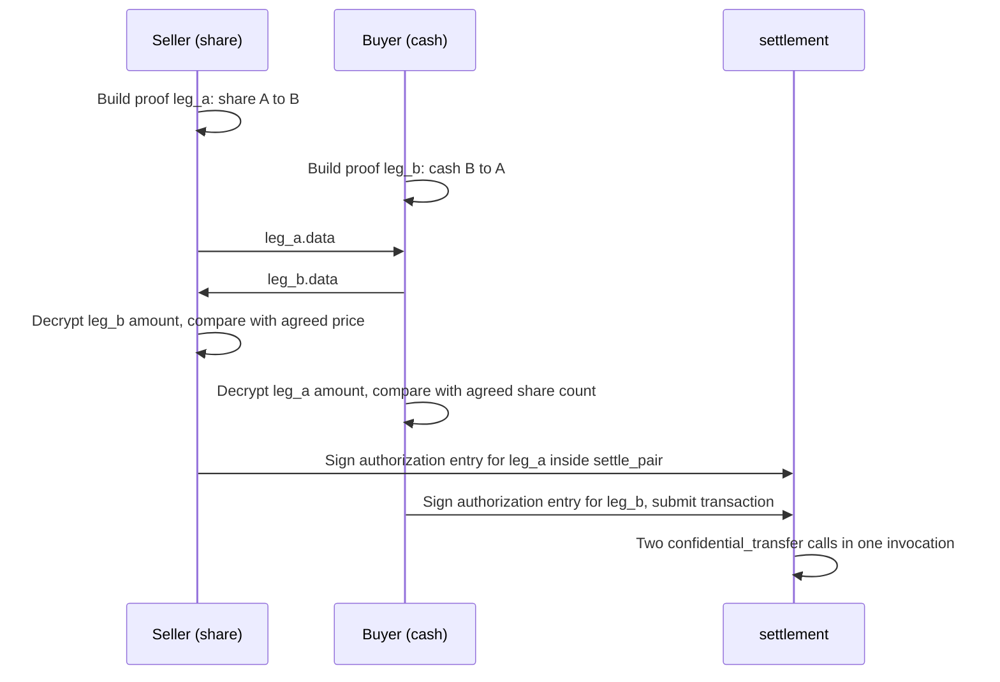

# Cell Seal: Cryptography

> Whatever belongs to the primitive is only summarised here, with a pointer to the OpenZeppelin spec
> (`packages/tokens/src/confidential/docs/protocol/`, branch `v0.9.0`). Whatever Cell Seal designs
> itself is described in full, because that is the part that must pass an independent cryptographic
> review before mainnet.

## 1. Taken verbatim from the primitive

| Component | Choice | Note |
|---|---|---|
| Curve | Grumpkin, forming a cycle with BN254 | Public keys, commitments and ECDH all live on Grumpkin |
| Commitment | Pedersen, `C = v*G + r*H`, not chunked | `v in [0, 2^127)`, enforced by a range constraint in the circuit |
| Hash | Poseidon2 sponge with a domain tag per purpose | The standard tags are in `domain-separators.md` of the spec |
| Amount encryption | Ephemeral ECDH per operation, then a one-time pad in the field: `v~ = v + Poseidon2(delta, s, sigma)` | Decryption is a subtraction. No discrete log to solve |
| Proof | Noir then UltraHonk, Aztec Ignition SRS, `bb prove -s ultra_honk --oracle_hash keccak` | Verified on chain with the BN254 and Poseidon host functions of Protocol 25 and 26 |
| Circuits | `register`, `withdraw`, `transfer`, `spender_transfer`, `set_spender`, `clawback` | `revoke_spender` on `v0.9.0` needs no proof |

Cell Seal **does not modify** any of these circuits, does not change a domain tag, and does not change
key derivation. Any deviation would make the SDK incompatible with other wallets and tools built on the
same primitive.

## 2. Anatomy of a confidential transfer

Notation: `v~` denotes the masked (encrypted) amount, `b~` the masked balance, `r~` a masked blinding
factor, `C` a Pedersen commitment, `R_e` the ephemeral public key of one operation, `sigma` the
per-operation salt, `delta_*` a Poseidon2 domain tag.

Sender `A` transfers `v` to recipient `B`. The `transfer` circuit enforces the following relations
(condensed from T1-T13 and T_a1-T_a9 of the spec):

| The sender computes | Formula | Used by |
|---|---|---|
| Ephemeral key | `R_e = r_e*H`, `r_e != 0` | The recipient and both auditors |
| Shared secret with the recipient | `s = ECDH(r_e, PVK_B)` | |
| Transfer blinding | `r_t = Poseidon2(delta_transfer_blind, s, sigma)` | Lets the recipient open the commitment |
| Transfer commitment | `C_t = v*G + r_t*H` | Added to `B`'s `receiving_commitment` |
| Encrypted amount | `v~ = v + Poseidon2(delta_transfer_amount, s, sigma)` | The recipient |
| `A`'s new balance | `C_spend' = (v_A - v)*G + r'*H`, `r' = Poseidon2(delta_spend_r, vk_A, sigma)` | Written to `A`'s `spendable_commitment` |
| Balance checkpoint | `b~ = (v_A - v) + Poseidon2(delta_enc_bal, vk_A, sigma)` | `A`'s wallet restores its state |
| Recipient's auditor channel | `v~_aud_r`, `r~_aud_r` under `ECDH(r_e, K_aud_r)` | The auditor can open `C_t` |
| Sender's auditor channel | `v~_aud_s`, `b~_aud_s`, `r~_aud_s` under `ECDH(r_e, K_aud_s)` | The auditor sees the amount, the post-transfer balance and the new blinding |

Three consequences for Cell Seal:

1. **The recipient can decrypt the amount before the transaction reaches the chain.** The payload
   already contains `R_e`, `v~`, `sigma`. The recipient computes `s = ECDH(vk_B, R_e)` and subtracts
   the mask. The proof binds `v~` to `C_t`. This is the basis of the DvP protocol in section 5.
2. **The proof is bound to the sender's current `C_spend`.** If the spendable balance changes between
   proof generation and execution, the proof breaks. `merge` also changes `C_spend`.
3. **The recipient does nothing to receive.** The contract adds `C_t` to `receiving_commitment`
   without any proof from the recipient. To spend it, the recipient must `merge` first.

`sigma` is freshly sampled for every operation. Reusing `sigma` breaks the confidentiality of every mask
derived from it. The SDK samples `sigma` from a CSPRNG with rejection sampling as the spec requires and
never accepts `sigma` from the caller.

## 3. Wallet state and recovery

The wallet keeps two *openings* off chain: `(v, r)` of `spendable_commitment` and of
`receiving_commitment`.

| Event | What the wallet does |
|---|---|
| `Transfer` / `SpenderTransfer` to me | Decrypt `(v_t, r_t)`, add to the receiving opening |
| `Deposit` to me | Add `(amount, 0)` to the receiving opening |
| `Merge` | Fold the receiving opening into spendable, reset receiving to 0 |
| `Transfer` from me, `Withdraw`, `SetSpender` | **Checkpoint**: re-read the spendable balance from `(b~, sigma)` |
| `RevokeSpender` | Add the allowance back, derived from `a_tilde` and `allowance_salt` |
| `Clawback` | Like `Merge`, then subtract the public `amount` from spendable |

If local state is lost, the wallet rebuilds from the latest checkpoint plus a replay of events in the
exact order `(ledger_seq, tx_application_order, event_index)`. Stellar RPC keeps events only for a
limited window, so the platform's event archive must store them permanently (reference: the sandbox
indexer, [`backend.md`](backend.md) section 6).
After every rebuild the SDK checks `v*G + r*H` against the on-chain commitment. On mismatch it refuses
to build proofs.

## 4. Sealed box for off-chain data

The amount of a fiat order never goes on chain, yet fund ops must read it and the backend must not.
Cell Seal uses a standard sealed box (X25519 + XSalsa20-Poly1305, libsodium's `crypto_box_seal`),
fully separate from the primitive's cryptography.

```
OrderSecret = {
  v: 1,
  order_id: bytes32,
  kind: "sub" | "red" | "pair",
  amount: string,
  currency: string,
  bank: { iban, bic, holder } | null,
  nonce: bytes16
}

ResultSecret = {
  v: 1,
  order_id: bytes32,
  shares: string,
  payout: string,
  nav: string,
  fee: string,
  nonce: bytes16
}

amount_ct_fund     = crypto_box_seal(canonical_json(OrderSecret), fund box_pk)
amount_ct_investor = crypto_box_seal(canonical_json(OrderSecret), investor box_pk)
result_ct_fund     = crypto_box_seal(canonical_json(ResultSecret), fund box_pk)
result_ct_investor = crypto_box_seal(canonical_json(ResultSecret), investor box_pk)
```

`canonical_json` is JSON with keys sorted, no whitespace, UTF-8. Every numeric field is a decimal
string left-padded with spaces to 32 characters, so every plaintext of one type has one length.
`nonce` is fresh per secret, so the fund copy and the investor copy of the same secret are not
linkable by ciphertext.

| Rule | Content |
|---|---|
| Two ciphertexts per secret | One for the fund, one for the investor, so the investor can re-read their own order on another device |
| Numeric fields are padded to a fixed length | A sealed box does not hide plaintext length. Without padding a larger number yields a longer ciphertext |
| `order_id` is inside the plaintext | If a ciphertext is attached to a different order, the client detects it at decryption |
| The backend only checks length and format | It has no key to do more, per P1 |
| Fields produced by fund ops | `ResultSecret` is produced at strike, sealed once to the fund and once to the investor. The `net` and the plan of the open window are sealed to the fund's box key only (`plan_ct_fund`) |

How the box key is derived: [`keys.md`](keys.md) section 4.

## 5. DvP protocol

The primitive has no swap and no cross-token circuit. Cell Seal builds DvP from two properties:
atomicity of a Soroban invocation, and the recipient's ability to check the amount before signing
(section 2, consequence 1).

### 5.1 `settle_pair`: two investors, both online



| Property | Why it holds |
|---|---|
| Atomic | One invocation. If one leg reverts the whole transaction reverts |
| Neither side can be cheated on the amount | Each side decrypts the `v~` of the leg it *receives* before signing. The proof binds `v~` to the commitment. A bad proof makes the chain revert both |
| No payload substitution | A Soroban authorization entry is bound to the exact function and arguments, including the `data` of both legs |
| No indefinite lock | Authorization entries have an expiry ledger. The SDK sets it 120 ledgers ahead, about 10 minutes. A proof breaks if the signer's spendable balance changes, so the SDK locks the wallet until the entry is used or expires |

### 5.2 `settle_dvp`: investor with the fund, investor need not be online at settlement

The order waits for strike and then for settlement, possibly for days. A proof built at order time
would break if the investor's balance changed in the meantime, and the price is not known at order
time anyway. The answer is an allowance:

| Step | Subscription paid in stablecoin | Redemption paid out in stablecoin |
|---|---|---|
| Place order | Investor `set_spender(cash wrapper, spender = settlement account, allowance = cash)` | Investor `set_spender(share wrapper, spender = settlement account, allowance = shares)` |
| Strike | Fund ops read the allowance via `a_tilde` (decrypted with the escrowed `dvk`), compute `shares = cash / NAV - fee` | Compute `payout = shares * NAV - fee` |
| Settlement | `settle_dvp(pull = cash investor to fund, pay = share fund to investor)` | `settle_dvp(pull = share investor to fund, pay = cash fund to investor)` |
| Cancel before settlement | Investor `revoke_spender`. The escrowed part returns to spendable | as on the left |

The allowance is split off from the spendable balance, so the investor keeps transacting normally
without breaking the pending order. `set_spender` refuses to overwrite an existing delegation for the
same `(account, spender)` pair, so **each investor has at most one pending DvP order per wrapper**.
A new order on the same wrapper waits until the pending one settles or is cancelled.

| Property | Status |
|---|---|
| Atomic | Yes. One invocation. Only the settlement account signs |
| The fund cannot pull without paying | Yes. The hook forces every `confidential_transfer_from` through `settlement`, and `settle_dvp` demands both symmetric legs |
| The fund cannot over-pull | Yes. The allowance is a ceiling, and the `spender_transfer` circuit enforces `v_a - v >= 0` |
| The chain enforces the price | **No.** The contract does not see amounts. The investor checks afterwards: decrypt the received leg, compare with `shares * NAV - fee` where NAV is read from `fund-registry` |
| Evidence in a dispute | The investor opens the received leg with the opening `(v, r_t)`. Anyone can check it against the on-chain `C_t` |

### 5.3 Price-linking circuit (after the first release)

For the chain to enforce the price itself, a new circuit must prove, over two commitments of two
tokens:

```
public:  C_share, C_cash, nav, fee_bps, scale
witness: v_share, r_share, v_cash, r_cash
enforce: C_share = v_share*G + r_share*H
         C_cash  = v_cash*G  + r_cash*H
         v_cash*scale*10000 = v_share*nav*(10000 - fee_bps)   (with a fixed rounding rule)
```

The prover must know both openings, which means the settlement account. This circuit needs its own
verifier because the primitive's `CircuitType` enum is fixed. Not part of the first release.

## 6. Threshold viewing key

### 6.1 Problem

The primitive's auditor key is **a single Grumpkin scalar** `k`, with public key `K = k*H`. Whoever
holds `k` can read every amount and every balance of the fund, forever. Cell Seal never lets `k`
exist in one place.

### 6.2 Key generation

Pedersen-style distributed key generation over the Grumpkin scalar field, `n` parties, threshold `k_t`.
Every message carries `ceremony_id`, `fund_id` and the sender's account, and is signed with the
sender's Stellar key, so messages of one ceremony cannot be replayed into another.

1. Each party `i` picks a random polynomial `f_i` of degree `k_t - 1` and publishes the coefficient
   commitments `A_i[j] = f_i[j]*H`, `j = 0 .. k_t - 1`, in the order store.
2. Sends `f_i(j)` to every party `j` through a sealed box to `j`'s box key, relayed by the order
   store. Party `j` checks `f_i(j)*H == sum_m A_i[m] * j^m`.
3. If a check fails, party `j` publishes a complaint naming `i`. The ceremony aborts and restarts
   with a new `ceremony_id` and fresh polynomials. There is no dispute protocol: the parties are
   known legal entities and a failed ceremony is handled by people.
4. Party `j`'s share: `k_j = sum_i f_i(j)`. Public key: `K = sum_i A_i[0]`. Each party publishes
   `K_j = k_j*H`, and every party checks `K_j == sum_i sum_m A_i[m] * j^m`.
5. The party that created the fund passes `K` to `create_fund`, which registers it in
   `seal-auditor` under the fund's `auditor_id`. Every party checks the on-chain key against its
   own `K` before using its share.

The order store only relays the encrypted messages and stores the public commitments. `K` uses the
generator `H`, the same one the primitive uses for `PVK` and in `ECDH(r_e, K_aud)`, so the auditor
can only open if `K = k * H`. Party indices
`j` are `1 .. n` in the order the parties are listed in the disclosure configuration of the fund.

### 6.3 Decrypting one event

Decryption only needs the point `S = k*R_e`. With a set `T` of `k_t` participating parties:

```
party i:  D_i = k_i*R_e, with a DLEQ proof that log_H(K_i) = log_{R_e}(D_i)
combine:  S = sum_{i in T} lambda_i*D_i        lambda_i are the Lagrange coefficients at 0
derive:   s = ECDH-KDF(S)                      the primitive's exact ECDH function
          mask = SpongeSqueeze(delta_aud_r or delta_aud_s, s, sigma)
          v = v~_aud - mask_v,  r = r~_aud - mask_r
check:    v*G + r*H == C_t                     the opening must match the on-chain commitment
```

The DLEQ proof is Chaum-Pedersen with Fiat-Shamir: party `i` picks a random `w`, computes
`A1 = w*H`, `A2 = w*R_e`, `c = SHA-256("cell-seal/v1/dleq" || H || K_i || R_e || D_i || A1 || A2
|| request_id)` reduced into the scalar field, `z = w + c*k_i`, and sends `(D_i, c, z)`. The reader
recomputes `A1 = z*H - c*K_i`, `A2 = z*R_e - c*D_i` and checks that `c` matches. `request_id` binds
the proof to one disclosure request. An event on the sender side of a transfer uses the sender's
auditor channel and therefore the sender's fund key. In a secondary transfer both parties are in the
same fund, so one key covers both channels.

| Property | Content |
|---|---|
| `k` is never reconstructed | Only the per-event `S` is combined |
| Scope is enforced at each key holder | A key holder's client computes `D_i` only for the `R_e` values that belong to the signed, approved disclosure request, and verifies that request itself |
| A wrong share is detected | A DLEQ (Chaum-Pedersen) proof per `D_i`. The final opening check catches anything that slips through |
| The reader gets exactly what was approved | They receive `S` per event. The `S` of one event is useless for any other event |
| Cost | One point multiplication and one DLEQ proof per event per party. One quarter of one fund is a few hundred events. Processed in batches in the browser |

### 6.4 Limits that must be stated

| Limit | Consequence | Handling |
|---|---|---|
| The `clawback` circuit takes `k_aud` as a witness | The threshold scheme cannot produce this proof without MPC proving | First release: clawback is a controlled ceremony. `k_t` parties reconstruct `k` in a temporary environment, build the proof, then `rotate_key` to a fresh DKG key in the same session. Logged in the unlock log |
| Readability only applies going forward | After `rotate_key`, the new key cannot read history | Key holders keep shares of every key epoch. A disclosure request states which epoch applies to each ledger range |
| No cold recovery for the auditor | Losing more than `n - k_t` shares makes that epoch's history unreadable through the auditor channel | The fund's register survives, because it does not depend on this channel (section 7) |

## 7. Register without the viewing key

The register must be updated daily, while the viewing key needs `k_t` parties. The two do not
conflict:

| Transaction type | How the fund learns the amount |
|---|---|
| Subscription | The settlement account is the sender. It knows |
| Redemption | The settlement account is the recipient. It decrypts with its own key |
| DvP | The settlement account is a party to both legs |
| Secondary transfer | The recipient sends the **opening** `(v, r_t)` to the fund, encrypted to the fund's box key. The fund's client checks `v*G + r_t*H == C_t` (`ops.register.verifyOpening`) |

`C_t` lives in the `data` argument of the contract call, not in the event, so the indexer stores the
invocation arguments of every call into `settlement` ([`backend.md`](backend.md) section 6).

The SDK on the receiving side sends the opening automatically as soon as `settle_pair` is confirmed.
The fund's client flags every secondary transfer without a valid opening. Periodic reconciliation with the
k-of-n viewing key catches the stragglers. A fund can tighten this by temporarily freezing the
receiving account until an opening arrives. This is a per-fund setting, off by default.

## 8. Position limit

The primitive's policy does not see amounts, so a limit cannot be enforced by the policy call.

| Phase | Method | Enforced where |
|---|---|---|
| First release | At subscription intake the fund's client computes `(holding + pending orders) / supply` from the register. Above the limit, the order is refused | Off chain, by the fund |
| After the first release | A circuit proving `v_holder*10000 <= limit_bps*supply` over the holder's commitment, with `supply` as a public input | On chain, needs its own verifier |

The first release cannot block a secondary transfer that breaches the limit. It only detects it
afterwards, through the opening of section 7. This is a known limit and must be stated in the fund-facing
documentation.

## 9. Proof generation

| Topic | Rule |
|---|---|
| Where it runs | A Web Worker in the signer's browser, using bb.js (WASM). Keys never leave the worker |
| Multithreading | Needs cross-origin isolation (`COOP: same-origin`, `COEP: require-corp`) to get `SharedArrayBuffer`. Without it, single-threaded and much slower |
| Timings | About 1 second per proof on a laptop, measured on testnet. Upstream reports 2.7-6.7 seconds multithreaded on a 4 GB phone and 10.8-15.7 seconds single-threaded in an Android WebView. On-chain verification costs 90-97 M instructions, 0.10-0.17 XLM per proof ([`primitives.md`](primitives.md) section 8) |
| Artifacts | ACIR and verification key pinned by hash in the SDK. Compared against `seal-verifier.get_verification_key` at startup |
| Tool versions | Locked set: nargo `1.0.0-beta.11`, bb `0.87.0`, upstream commit `5ffda91` with the Nethermind verifier. The six verification keys rebuild byte-identical with this set |
| Non-zk flavour | The upstream recipe does not enable `--zk`, and the verifier currently implements only the non-zk `ultra_flavor`. A non-zk proof may leak information about the witness. This is a risk outside Cell Seal's control and a condition for lifting the pilot cap ([`security.md`](security.md) section 6) |

## 10. Cell Seal's own design: scope of the cryptographic review

| # | Item | Section |
|---|---|---|
| R1 | Sealed box for the order secret: format, `order_id` binding | Section 4 |
| R2 | DvP protocol: `settle_pair`, `settle_dvp`, the atomicity and authorization-entry arguments | Section 5 |
| R3 | DKG, threshold decryption, DLEQ proofs, scope enforcement | Section 6 |
| R4 | Clawback ceremony with key reconstruction | Section 6.4 |
| R5 | Opening for the register and its verification | Section 7 |
| R6 | Box key derivation and the settlement account's raw root | [`keys.md`](keys.md) |
