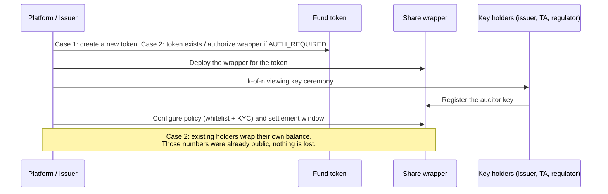
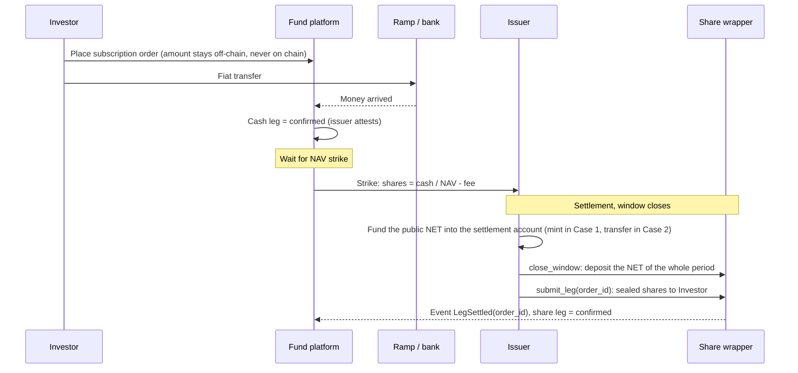
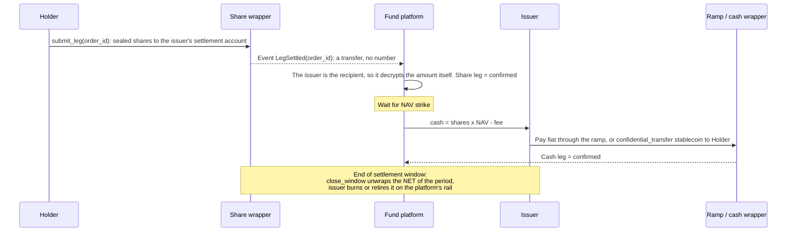
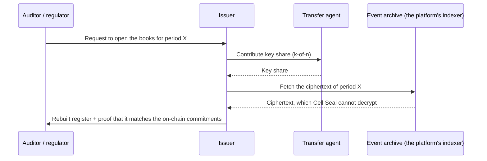

# Cell Seal: Flows

> Read [`overview.md`](overview.md) first. This document describes each business flow at the level
> of "who does what, what goes on chain, what the market sees". Contract signatures:
> [`contracts.md`](contracts.md). Data flow through the SDK and its host services: [`architecture.md`](architecture.md) section 8.

## 1. Order model

Every subscription, redemption and secondary transfer is an **order with two legs**.

| Leg | What it is | Where it can live |
|---|---|---|
| Share leg | Fund shares change hands | Always on-chain, inside the share wrapper, sealed |
| Cash leg | Money changes hands | Off-chain (fiat through a ramp, issuer attests) **or** on-chain inside the cash wrapper, sealed |

Each leg has its own status: `pending`, then `delivered`, then `confirmed`. The status changes only
when the chain has confirmed (on-chain leg) or when the issuer attests (off-chain leg). The order is
done when both legs are `confirmed`.

| Mode | How the two legs are tied | Cash leg |
|---|---|---|
| **DoP** | Separate. The second leg is triggered only when the first is `confirmed` | Fiat or sealed stablecoin |
| **DvP** | One transaction, all-or-nothing. Each side checks the other side's amount before signing | Sealed stablecoin |

Two moments are kept apart: **strike** is when the NAV is published and orders are priced.
**settlement** is when the settlement window closes, when the net is wrapped or unwrapped and the
shares of new subscriptions are actually delivered. Before settlement, the net shares of the period
are not yet inside the wrapper. Minting and burning the fund token is the issuer's job on the
platform's rail, not the job of `settlement` ([`integration.md`](integration.md) section 4).

Every sealed transfer goes through the `settlement` contract with an `order_id`. Its events are what
the order store (the platform's, or the sandbox backend's) uses to change leg status.

Mode is a property of the order, not of the fund: the same fund can take subscriptions in fiat
(DoP) and let holders transfer on the secondary market in stablecoin (DvP).

## 2. Onboarding a fund

Case 1, a new fund: the platform issues the token and deploys the wrapper in the same pass, so no
holder has to wrap and no balance was ever public. Case 2, an existing token: holders who have not
wrapped stay on the platform's public rail, and the fund runs two rails side by side,
[`integration.md`](integration.md) section 5. The sandbox apps implement Case 1, screens
[`design/`](design/README.md) 01 to 03. Step-by-step procedures for both cases:
[`onboarding.md`](onboarding.md).

From this point the public register shows only the wrapper as holder (Case 1), or the wrapper plus
the holders who have not wrapped (Case 2). The real register is rebuilt from data decrypted with the
viewing key.

## 3. Subscription

### 3.1 DoP, fiat (default)

The market sees: the issuer deposits one **total** into the wrapper per period, and one sealed
transfer to the investor's address. It does not see how much the investor bought.

### 3.2 DvP, stablecoin

The investor wraps stablecoin into the cash wrapper first (the wrap amount is public, but tied to no
order). At settlement, one `settle_dvp` call pulls sealed cash from the investor to the issuer and
delivers sealed shares from the issuer to the investor. The investor delegates (spender) the cash
part when placing the order, so the order still executes even if their balance changes while
waiting.

## 4. Redemption

### 4.1 DoP

The key point: the holder **does not unwrap**, and the redemption order **carries no plaintext
amount**. The market sees that the holder sent something to the issuer. It does not see how much.
The only number that comes out is the net of the whole period.

### 4.2 DvP

The holder delegates the shares to redeem to the fund's settlement account when placing the order.
At settlement, `settle_dvp` moves sealed shares from holder to issuer and sealed cash from issuer to
holder in one call. If one leg fails, neither happens.

## 5. Secondary transfer between two holders: DvP

Both holders have passed policy. Seller and buyer agree on a price off-chain, then one transaction
swaps sealed shares for sealed cash. This is the only flow where DvP is **mandatory**: the two sides
have no reason to trust each other.

The issuer is not part of the transaction. The side receiving shares sends the *opening* of its leg
to the fund so the register updates immediately. The k-of-n viewing key is used for periodic
reconciliation. Policy still blocks transfers to addresses that are not whitelisted.

## 6. Settlement window

| During the period | At the end |
|---|---|
| Every subscription and redemption is a sealed transfer inside the wrapper | The issuer computes the net: subscriptions minus redemptions |
| The wrapper balance does not change | Net positive: the issuer funds the public amount into the settlement account, `close_window` wraps it. Net negative: `close_window` unwraps, the issuer burns or retires. Net zero: no token moves, the window still closes and emits `WindowClosed`. `settlement` neither mints nor burns |
| The market sees no number | The market sees **one** number: the net of the period |

The window runs on schedule even when there are no orders, so that "this period had an unwrap" is
not by itself a signal.

## 7. Disclosure

Every unlock leaves a trace: who requested, who contributed a share, which scope.

## 8. Where amounts can leak

The business view. The master list with ids L1 to L18 and the technical mitigation of each is
[`security.md`](security.md) section 3.

| Where | Why it leaks | Handling |
|---|---|---|
| The platform's order event has an amount field | Size is exposed at request time | Orders carry only the order reference |
| Payout in public stablecoin | payout / NAV = number of shares | The on-chain cash leg is always sealed |
| The holder unwraps to redeem | Unwrap is public | Redeem by a transfer inside the wrapper |
| Unwrap right after a large order | Timing matches the order | Unwrap on a fixed window |
| Fee paid separately by a public transfer | fee / fee rate = size | Fee is computed inside the same sealed transfer |
| Too few orders in one period | Net is roughly one order | Longer window, configured per fund |
| The issuer wraps straight to the investor's address | Wrap has a public amount with the recipient address | Always wrap into the issuer's settlement account, then transfer sealed |
| An investor registers with an `auditor_id` outside the fund | The fund cannot read that investor's amounts | Enforce the fund's `auditor_id` at registration |
| Case 2: the platform mints public shares straight to an investor who then wraps | Public amount, tied to an address | New shares for a sealed investor always go from the settlement account inside the wrapper. Self-wrap is only for a balance already held, [`integration.md`](integration.md) section 5 |
