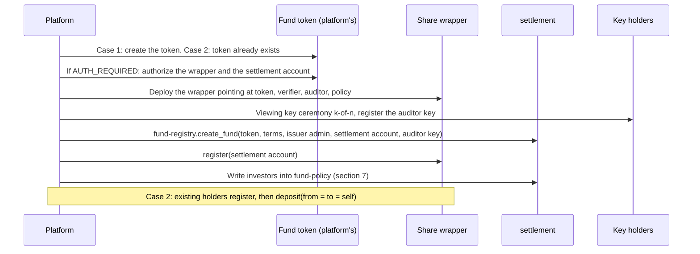

# Cell Seal: Integration

> Cell Seal sells **contracts plus an SDK** to tokenization platforms. This document answers: what
> the platform owns, what Cell Seal owns, what a fund token must satisfy, who changes the public
> supply, and which invariants the platform's indexer reconciles. The step-by-step procedure for bringing a
> fund onto the rail, in both cases (no token yet, existing token), is in
> [`onboarding.md`](onboarding.md). Decided 2026-10-24. The parts of the current prototype not yet
> updated to this document are listed in section 8.

## 1. Product boundary

| | The tokenization platform owns | Cell Seal provides |
|---|---|---|
| Fund token | Issuer account, token contract (SAC or custom SEP-41), the **mint and burn** rights, asset flags | No rights on the token. The wrapper only calls `transfer` to move tokens into and out of its pool |
| Investors | KYC, whitelist, records, the contract with the fund | `fund-policy`: an on-chain copy of investor status, written by the platform through the SDK |
| Order lifecycle | Request, cut-off, NAV, approval, payout, reconciliation, every screen | `settlement`: order reference, sealed legs, DvP, settlement window |
| Figures | NAV, dealing calendar, register, reporting | A register rebuilt from decrypted data, by the SDK, in the fund's browser |
| Keys | Wallets of investors and of fund ops | Privacy key derived from a wallet signature, proof generation, decryption, sealed box: all in the SDK |
| Infrastructure | Its backend, database and apps, including the three host services the SDK needs: Stellar RPC, a permanent event archive, an order store for ciphertext ([`sdk.md`](sdk.md) section 2.1) | The SDK, the interface of each host service, and a reference implementation of the event archive in the sandbox |

The product has three parts: the contract set (`seal-token` wrapper, `settlement`, `fund-policy`,
`seal-verifier`, `seal-auditor`, `fund-registry`), `@cell-seal/sdk`, and the onboarding procedure
in [`onboarding.md`](onboarding.md). The **sandbox** is a reference tokenization platform with the
rail integrated: an amount-blind backend ([`backend.md`](backend.md)), a fund console and an
investor app ([`frontend.md`](frontend.md), [`design/`](design/README.md)). A platform uses it to
run one full cycle before integrating the SDK into its own apps, and reads it as a worked
integration. It is not the product and is not operated for real funds.

Each tokenization platform runs **one shared contract set** (`settlement`, `fund-policy`,
`seal-verifier`, `seal-auditor`, `fund-registry`) and **one wrapper per fund**. The platform admin
key (K6 in [`keys.md`](keys.md)) belongs to the platform. Cell Seal keeps the audited wasm hashes
and publishes new releases.

## 2. Two onboarding cases

| | **Case 1: the fund has no token yet** | **Case 2: the fund already has a token** |
|---|---|---|
| Fund token | The platform creates the token together with the wrapper | The token exists and has public holders |
| Supply at start | 0 | Partly or fully held by public holders |
| Public cap table | Shows only the wrapper as holder, from the first transaction | History before the wrap date is public and cannot be erased |
| Existing holders | None | Self-wrap their balance if they want, or stay public |
| State after onboarding | Every share is sealed | **Hybrid**: part public on the platform's rail, part sealed in the wrapper |
| Extra work for the platform | None | Authorize the wrapper and the settlement account on the token (section 3), guide holders to wrap, run two rails side by side |
| Contract differences | None. Case 1 is Case 2 with an initial supply of 0 | |

Both cases use the same contract set, the same SDK and the same `close_window` procedure. The
differences are in the token (section 3) and in the platform accepting a hybrid state (section 5). The
procedures, checklists and the first settlement window of each case are in
[`onboarding.md`](onboarding.md).

### 2.1 Onboarding order

## 3. What the fund token must satisfy

| Condition | Why | Case 1 | Case 2 |
|---|---|---|---|
| A SEP-41 contract (SAC of a classic asset, or a Soroban token) | The wrapper calls `transfer(from, wrapper, amount)` and `transfer(wrapper, to, amount)` | Chosen at creation | Check |
| 7 decimal places | Amounts in the circuits and in `settlement` are `i128` at scale `10^7` | Set at creation | A token with another scale is converted by the SDK at the boundary. Recorded in the fund configuration |
| If `AUTH_REQUIRED`: the wrapper contract and the settlement account are authorized by the issuer | The wrapper holds the pool. The settlement account receives the public net | Done at creation | One issuer operation before the wrapper is deployed |
| If `AUTH_CLAWBACK_ENABLED`: the issuer commits not to claw back the wrapper address | Clawing back the wrapper's pool breaks the backing of every sealed balance | Leave the flag off | Contractual commitment, or clear the flag if no holder needs it yet |
| No SEP-8 (regulated asset, per-transaction approval) | The SEP-8 authorize/deauthorize sandwich applies only to classic transactions. A `transfer` invoked by a contract does not go through the approval server. A holder's `deposit` would be rejected | Do not use | **Blocker.** A platform on SEP-8 must move transfer control for the sealed part to `fund-policy` and keep SEP-8 for the public part |
| Mint and burn stay with the platform's issuer | Cell Seal does not hold and does not ask for issuance rights | | |

The asset flags and SEP-8 cannot be checked by the contracts at deploy time. They are the platform's
onboarding checklist ([`onboarding.md`](onboarding.md) section 4.2). The SDK checks that `balance(wrapper)` changes by exactly the amount after
the first `deposit`, to detect a blocked token.

## 4. Supply: who mints, who burns, what `close_window` does

Principle: **`settlement` does not mint and does not burn.** It only wraps and unwraps the net of
the window, between the settlement account and the wrapper. Creating and destroying fund tokens is
the issuer's job, on the platform's rail.

| Step | Case 1 (token created by the platform) | Case 2 (existing token) |
|---|---|---|
| Before `close_window`, `net > 0` | The issuer mints `net` public tokens into the settlement account | The issuer transfers `net` public tokens from the issuing account (or treasury) into the settlement account |
| `close_window(net > 0)` | `deposit(from = to = settlement account, net)`: `net` public tokens leave the settlement account for the wrapper's pool. The settlement account receives `net` sealed | same |
| `close_window(net < 0)` | `withdraw(from = to = settlement account, \|net\|, proof)`: `\|net\|` public tokens leave the pool for the settlement account | same |
| `close_window(net = 0)` | No token moves. The window closes, `WindowClosed` is emitted, the next window opens | same |
| After `close_window`, `net < 0` | The issuer burns the `\|net\|` public tokens sitting in the settlement account | The issuer recalls `\|net\|` to the issuing account, or burns |

Two checks `settlement` runs before wrapping: `balance(token, settlement account) >= net` (error
`4108 NetNotFunded`), and the window is due (`4104 WindowNotDue`). Two signatures are still
required: the settlement account for `deposit` / `withdraw`, and the issuer admin as the approval
of the net figure that is about to become public.

What the market sees is unchanged from the earlier design: once per window, **one** aggregate
number moves between the issuer and the settlement account, then between the settlement account and
the wrapper. There is no per-investor figure. What changes is that the guarantee "supply changes by
exactly `net`" moves from the contract to the issuer's discipline. The platform's indexer reconciles (section 6) to
detect drift.

Between the issuer funding the account and `close_window` running, the settlement account holds
unwrapped public tokens. This interval should be short: the SDK folds the two steps into one
operator action, fund then close immediately.

## 5. The hybrid state in Case 2

Public holders on the platform are not forced to wrap. The fund therefore runs two rails until every
holder has wrapped, possibly forever:

| | Public rail (the platform's) | Sealed rail (Cell Seal) |
|---|---|---|
| Who | Holders who have not wrapped | Holders who have called `deposit` into the wrapper |
| Subscription | The issuer mints or transfers public tokens to the holder, public amount | `settlement account to investor` inside the wrapper, sealed amount |
| Redemption | The holder transfers public tokens back to the issuer, public amount | `investor to settlement account` inside the wrapper, sealed amount |
| Moving from one rail to the other | The holder calls `deposit(from = to = self)`: public amount, but a balance that was already public | Only through a redemption. Investors never `withdraw` (L3) |
| Register | The token's public balances | Register rebuilt from decrypted data |
| What the public cap table shows | Each public holder, and the wrapper as **one** holder | |

Rules for the platform in Case 2, so that the sealed part does not leak through the public part:

- New shares for a sealed investor always go `settlement account to investor` inside the wrapper.
  Never mint public tokens to an investor and let them self-wrap: that amount is public and tied to
  an address.
- Holders self-wrap **existing balances only**. The wrapper allows `deposit` with `from == to` for
  any account approved by the policy. This is a change from the old `on_deposit` rule (settlement
  account only) and is listed in section 8.
- The `net` of a window counts the sealed part only. The platform adds its public figures on its
  side.

## 6. Reconciliation

The old invariant T1 (`total_supply(token) = balance(wrapper)`) no longer holds: in Case 2 there
are public holders, and in Case 1 the settlement account may briefly hold unwrapped tokens. The new
invariants:

| # | Invariant | Checked where |
|---|---|---|
| T1 | `balance(token, wrapper)` = the sum of all sealed claims inside the wrapper | The primitive's conservation proof. The fund reconciles its register with `balance(wrapper)` |
| T1a | `balance(token, wrapper)` after `close_window` = `supply_after` in the `WindowClosed` event | The platform's indexer (reference: sandbox `seal-jobs`, [`backend.md`](backend.md) section 6.3) |
| T1b | `balance(token, wrapper)` changes only at `close_window` and at a holder's self-wrap `deposit` (Case 2) | The platform's indexer matches the wrapper's `Deposit`/`Withdraw` events against `WindowClosed` |
| T1c | Every `WindowClosed` with `net > 0` is preceded by one issuer funding of exactly `net` into the settlement account. With `net < 0` it is followed by one recall of exactly `\|net\|` | The platform's indexer reads the fund token's `transfer`/`mint`/`burn` events. Any drift raises the highest alert level |

`supply_after` in `WindowClosed` is the wrapper's token balance, that is the **sealed supply**, not
the `total_supply` of the fund token.

## 7. Integration points and the SDK

| Point | The platform does | The SDK provides |
|---|---|---|
| Onboard a fund | Create or pick the token, authorize, viewing key ceremony, `create_fund` | `seal.platform.deployFund(params)`, `ops.accounts.register({ wrappers })` |
| Investors | When KYC changes, write it to `fund-policy` | `ops.investors.set(account, status, kycExpiry)` |
| Holder self-wrap (Case 2) | A "Move your shares to sealed" screen in the platform's app | `seal.token(wrapper).register({ auditorId })`, then `seal.token(wrapper).wrap(amount)` |
| Orders | Orders carry only `order_id`, never an amount | `seal.orders.createSubscription`, `seal.orders.createRedemption`, the sealed box for the off-chain amount. Share delivery is part of `ops.window.close(plan)` |
| Window | Before closing: fund `net` public tokens into the settlement account on the platform's rail. After closing with `net < 0`: recall | `ops.window.plan()` returns `net`. `ops.window.close(plan)` calls `close_window` then delivers shares. The SDK does not mint and does not burn |
| Register | Rebuild the register from decrypted data in the fund's browser | `ops.register.build()` |
| Disclosure | Key holders approve by scope | `threshold/` |

Order of operations for one window on the platform side:

1. `plan = ops.window.plan()`: `net`, number of orders, cover level.
2. If `net > 0`: the issuer funds `net` public tokens into the settlement account (mint in
   Case 1, transfer in Case 2). If `net < 0`: nothing before.
3. `ops.window.close(plan)`: `close_window(net)`, then `submit_leg` for every subscription.
4. If `net < 0`: the issuer recalls `|net|` public tokens from the settlement account.
5. The platform's indexer reconciles T1a to T1c.

## 8. Changes against the current prototype

The testnet prototype was written before the decision above. What must change, in order:

| # | Today | Must become | Where |
|---|---|---|---|
| 1 | `close_window` calls `mint(to, amount, operator)` on the fund token when `net > 0`, `burn` when `net < 0` | No call on the fund token other than `balance`. Check `balance(settlement account) >= net` before `deposit` (`4108 NetNotFunded`) | `settlement/src/contract.rs` |
| 2 | `on_deposit`: `from == to == settlement account` | `from == to`, and `to` passes the policy. Settlement account and investors can both self-wrap | `seal-token` `SealHooks` |
| 3 | `share-token` is the fund's token | `share-token` is a sample token for tests and the Case 1 demo only. Its issuer mints into the settlement account before `close_window` | `share-token`, the testnet deploy script, the `cycle` test |
| 4 | `supply_after` reads `balance(wrapper)` | Unchanged. The meaning is renamed: sealed supply | Docs |
| 5 | Missing | Case 2 integration test: wrapper pointing at the SAC of an existing classic asset, holder self-wraps, window closes with `net < 0`, issuer recalls | `settlement/src/test/`, testnet |
| 6 | `create_fund` always deploys `share-token` | `create_fund` takes the address of an existing token (production, both cases) or deploys the sample token (sandbox only) | `fund-registry`, [`contracts.md`](contracts.md) section 7 |

Invariants T1 and C3 in [`contracts.md`](contracts.md) section 9 are restated from section 6 above.
