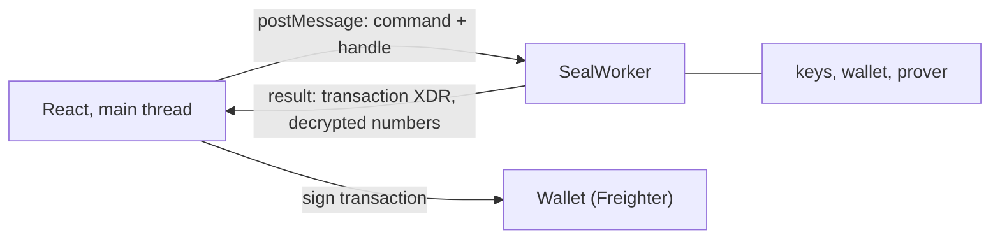

# Cell Seal: Client SDK

> Package `@cell-seal/sdk`, TypeScript. It is the only place in the system that touches private
> keys and plaintext amounts. OpenZeppelin ships a spec for an SDK (`docs/sdk/` on `v0.9.0`) but
> does not ship an SDK. This package implements that spec and adds the Cell Seal layer. It is a
> **product**: a tokenization platform integrates this package into its own app and backend
> ([`integration.md`](integration.md) section 7). It needs three services from its host,
> section 2.1. The sandbox backend is one implementation of them.

## 1. Goals

| Goal | Meaning |
|---|---|
| Compatible with the primitive | Passes the test vectors in the upstream `docs/sdk/conformance.md`. Another wallet built on the same primitive can read an account created by this SDK, and the other way round |
| Keys never leave the Web Worker | The main thread only sees opaque handles, never `sk`, `vk` or a root |
| Usable outside Cell Seal | The `core` and `token` layers depend on neither the Cell Seal contracts nor any backend. This is the public-good part |
| Refuse rather than guess | Artifact hash mismatch, opening not matching the commitment, non-deterministic signature: throw a coded error, never self-correct |

## 2. Layers

```
@cell-seal/sdk
|-- core/        Grumpkin, Poseidon2, Pedersen, ECDH, address-to-field, scalar sampling
|-- keys/        signer root, raw root, derivation of sk, vk, dvk, box key
|-- prover/      bb.js in a Web Worker, artifact management, proof queue
|-- wallet/      openings, event replay, checkpoints, merge, wallet lock while work is pending
|-- token/       seal-token client: register, transfer, set_spender, withdraw, merge
|-- box/         sealed box: OrderSecret, envelopes
|-- threshold/   DKG, partial decrypt, DLEQ, combine
|-- seal/        Cell Seal specific: settlement, fund-registry, orders, openings
`-- rpc/         Stellar RPC plus event archive, stitched at the seam
```

`core`, `keys`, `prover`, `wallet` and `token` implement the upstream spec. `box`, `threshold` and
`seal` belong to Cell Seal.

### 2.1 Host services

The SDK runs inside the platform's app and talks to three services the platform provides. None of
them sees an amount.

| Service | What the SDK needs | Reference implementation |
|---|---|---|
| Stellar RPC | `getEvents`, `getTransaction`, simulation, submission | Any Stellar RPC |
| Event archive | Every event of the Cell Seal contracts, kept permanently, served in global order per account, plus the stored invocation parameters of `settlement` calls and a checkpoint per account. The endpoints follow the upstream `docs/indexer.md` | The sandbox `indexer` crate, [`backend.md`](backend.md) section 4.5 and section 6. A platform may run it as is or serve the same endpoints from its own indexer |
| Order store | Stores order metadata and sealed boxes (`*_ct` fields), attestations, envelopes, DKG messages, disclosure requests, and returns them by role. Holds no key | The sandbox `gateway` and `orders` crates, [`backend.md`](backend.md) section 4. A platform maps these calls onto its own order system |

`connect` takes one URL per service. The `core`, `keys`, `prover`, `wallet` and `token` layers use
only Stellar RPC and the event archive. The order store is needed by `box`, `threshold` and `seal`.

## 3. Worker model



The main thread cannot import the modules that hold keys. `SealWorker` is the single entry point
and exposes only a message-based API. Decrypted amounts *are* returned to the main thread because
the UI has to display them. Keys are not.

## 4. API

### 4.1 Session

```ts
const seal = await SealClient.connect({
  network: "testnet",
  rpcUrl, indexerUrl, apiUrl,   // the three host services, section 2.1
  registry: "C...",
  wallet: freighterAdapter,
});

await seal.unlock();
await seal.lock();
seal.on("locked" | "synced" | "proofProgress", handler);
```

`unlock()` requests the root signature from the wallet (twice, and compares), checks the signature
against the expected public key, derives the keys inside the worker, then overwrites the signature.
It throws `E_NONDETERMINISTIC_SIGNER` if the two signatures differ and `E_SIGNER_MISMATCH` if the
signature does not belong to the selected account.

### 4.2 Accounts and balances

```ts
await seal.token(wrapper).register({ auditorId });
const bal = await seal.token(wrapper).balance();
// { spendable: bigint, receiving: bigint, pendingAllowances: Allowance[], syncedLedger: number }
await seal.token(wrapper).merge();
await seal.token(wrapper).wrap(amount);   // deposit(from = to = self, amount): the amount is public
```

`wrap` is the only investor-side call with a public amount. It exists for two cases: a Case 2
holder moving an existing public balance into the share wrapper, and an investor topping up a cash
wrapper before a DvP order. The SDK shows the public-amount warning from
[`security.md`](security.md) section 3 (L9) before building the transaction.

`balance()` syncs first: it reads the event tail from RPC and the older part from the indexer,
stitches them at the seam, replays them into the openings, then checks `v*G + r*H` against the
on-chain `confidential_balance()`. On a mismatch it throws `E_STATE_DIVERGED` and forces a rebuild
from the checkpoint.

### 4.3 Orders

```ts
const order = await seal.orders.createSubscription({
  fundId, amount: "12400000.00", currency: "EUR", pay: "bank",
});
// -> { orderId, reference, wire: { iban, bic, beneficiary } }

const order = await seal.orders.createSubscription({ fundId, amount, pay: "cash:EURC" });
// SDK: merge if needed -> set_spender(cash wrapper, settlement account, allowance = amount)

const order = await seal.orders.createRedemption({ fundId, shares: "47952431.18", receive: "bank" });
// SDK: merge if needed -> submit_leg(order_id, Share, investor -> settlement account)

const order = await seal.orders.createRedemption({ fundId, shares, receive: "cash:EURC" });
// SDK: set_spender(share wrapper, settlement account, allowance = shares)

await seal.orders.cancel(orderId);
const list = await seal.orders.list({ fundId });
const one = await seal.orders.get(orderId);
// { orderId, reference, kind, pay, status, shareLeg, cashLeg, amount: bigint, result?: bigint, wire? }
```

`list` and `get` fetch the metadata from the order store, open `amount_ct_investor` and
`result_ct_investor` in the worker, and return the amounts as `bigint`.

Every `create*` call runs the same chain of work: generate `order_id`, build the `OrderSecret`,
seal two copies, send metadata and ciphertext to the order store, and, if there is an on-chain leg,
build the transaction, generate the proof, hand it to the wallet to sign, submit, and wait for the
indexer to confirm.

### 4.4 Fund side

```ts
const ops = await seal.fund(fundId).asOps();

await ops.accounts.register({ wrappers });   // share wrapper plus every cash wrapper of the fund
await ops.investors.set(account, "Approved", kycExpiry);   // fund-policy.set_investor, then the order store

const orders = await ops.orders.list({ status: "awaiting_price" });
await ops.orders.attest(orderId, "cash_received");
await ops.orders.attest(orderId, "cash_paid");
await ops.orders.hold(orderId);     // also release(orderId), reject(orderId)

await ops.nav.publish({ dealingDay, nav: "1.0427" });
const priced = await ops.nav.priceOrders(dealingDay);

const plan = await ops.window.plan();
// { net: bigint, deliveries: Leg[], dvp: DvpOrder[], cover: { orders: number, largestShare: number } }
await ops.window.close(plan);

const register = await ops.register.build();
await ops.register.verifyOpening(orderId, opening);

const ceremonyId = await ops.dkg.start({ holders, threshold });
const requestId = await ops.disclosure.request({ reader, scope, fromLedger, toLedger, expiresAt });
await ops.disclosure.cancel(requestId);
```

`ops.accounts.register` registers the settlement account in the share wrapper and in every cash
wrapper of the fund, with the fund's `auditor_id`, using the privacy key derived from `ops_root`.
It runs once, right after `deployFund`.

`ops.nav.priceOrders` computes `shares` or `payout` for every order of the dealing day in the
worker, seals the result twice (`result_ct_fund`, `result_ct_investor`) and posts both to the
order store. The order moves to `priced` only after that call.

`window.close` does not mint and does not burn. Before calling `close_window` the SDK reads the
settlement account's public balance of the fund token and compares it with the plan:

| Condition | SDK |
|---|---|
| `next_close` not reached | Throws `E_WINDOW_NOT_DUE`, builds nothing |
| `net > 0` and balance below `net` | Throws `E_NET_NOT_FUNDED`. The issuer has not funded the account |
| Balance above `net` (or above 0 when `net <= 0`) | Throws `E_NET_OVERFUNDED`. A surplus is leak L16 |
| Balance equals `net` | Proceeds |

With `net < 0`, after closing, the SDK reports the public amount now sitting in the settlement
account so the issuer can retire it ([`integration.md`](integration.md) section 4).

`window.close(plan)` runs in a fixed order: `close_window(net)`, then deliver shares to each DoP
subscription with `submit_leg`, then `settle_dvp` for each DvP order. The proofs depend on each
other through the settlement account's `C_spend`, so they are generated **sequentially**. The SDK
precomputes each `C_spend'` so the next proof can be built without waiting for the previous
transaction to confirm, then submits them one by one. If a transaction fails, it stops, resyncs,
and regenerates the remaining proofs.

### 4.5 Secondary transfer

```ts
const offer = await seal.pair.propose({ fundId, counterparty, shares, cash, cashWrapper });
const check = await seal.pair.inspect(incomingOffer);
// { theyDeliver: bigint, matchesAgreed: boolean }
await seal.pair.accept(incomingOffer);
```

`inspect` decrypts the amount of the leg this side receives and returns it for the UI to show.
`accept` signs only when `matchesAgreed`. After `settle_pair` is confirmed, the SDK of the side
receiving shares sends the opening to the fund automatically.

### 4.6 Key holder

```ts
const holder = await seal.keyHolder(fundId);
await holder.dkg.join(ceremonyId);
const requests = await holder.requests.list();
await holder.requests.approve(requestId);   // or decline(requestId)
const result = await seal.disclosure.open(requestId);
// { entries: [{ ledger, txHash, orderId?, from, to, amount: bigint, verified: boolean }] }
```

`dkg.start` is called by fund ops (section 4.4) and returns the `ceremonyId` that each key holder
passes to `dkg.join`. `join` runs the holder's side of the DKG in the worker, relays the encrypted
messages through the order store, and keeps the resulting share `k_j` in memory, plus one sealed
backup envelope ([`keys.md`](keys.md) section 5).

`approve` re-checks the scope of the request against the event list fetched from the indexer,
computes `D_i` with a DLEQ proof for every `R_e` in scope, and uploads them. `open` runs on the
reader's side: it collects `k_t` sets of partials, checks the DLEQ proofs, combines, decrypts, and
checks the opening against the commitment.

### 4.7 Platform onboarding

Calls the platform uses to put a fund on the rail ([`onboarding.md`](onboarding.md),
[`integration.md`](integration.md) section 7):

| Step | Call | Signer |
|---|---|---|
| Deploy the fund's wrapper and register it with `settlement` and `fund-registry` | `seal.platform.deployFund(params)` | Issuer admin |
| Register the settlement account in the share wrapper and cash wrappers | `ops.accounts.register({ wrappers })` | Settlement account |
| Mirror an investor's KYC status into `fund-policy` | `ops.investors.set(account, status, kycExpiry)` | Fund ops with the `compliance` role |
| Holder self-wrap of an existing public balance (Case 2) | `seal.token(wrapper).register({ auditorId })`, then `seal.token(wrapper).wrap(amount)` | The holder |

```ts
const { fundId, wrapper, auditorId } = await seal.platform.deployFund({
  token,                 // existing token address (Case 2), or omitted: deploy the sample token (Case 1, sandbox)
  issuerAdmin, settlementAccount,
  auditorKey,            // K from the DKG, 64 bytes
  params,                // FundParams: name, symbol, currency, manager, terms
});
```

`deployFund` calls `fund-registry.create_fund`, waits for the event, then posts the public fund
record to the order store. It returns the ids the next steps need. The sealed box key of the fund
(`box_pk`) is generated in the same call, written to `FundInfo` on chain and registered with the
order store.

## 5. Prover

| Topic | Rule |
|---|---|
| Artifacts | `{circuit}.json` (ACIR) and `{circuit}.vk`, lazily loaded, cached in Cache Storage by hash |
| Pinning | A `circuit -> sha256` table compiled into the SDK. On `connect`, the SDK compares the `vk` with `seal-verifier.get_verification_key`. On a mismatch it throws `E_VK_MISMATCH` and locks every proof-generating operation |
| Multithreading | Used when the page is cross-origin isolated. The SDK exposes `seal.capabilities.threads` so the UI can estimate durations |
| Queue | One proof at a time per account, because each proof depends on the `C_spend` produced by the previous one |
| Progress | `proofProgress` event by stage: `witness`, then `prove`, then `done` |
| Cancel | Cancellable in the `witness` stage. In `prove` it waits for completion and discards the result |

## 6. Wallet lock while work is pending

A proof is bound to `C_spend` at the time it is built. The SDK keeps one logical lock per
(wrapper, account) pair:

| State | Allowed |
|---|---|
| `idle` | Every operation |
| `proof_built`: proof generated, transaction not yet confirmed | No operation that changes `C_spend`, including `merge` |
| `pair_pending`: one leg of `settle_pair` signed, waiting for the counterparty | As above, until the authorization entry expires |

DvP orders with the fund do **not** lock the wallet: the allowance is already separated from
`C_spend`.

## 7. Error codes

| Code | Meaning | What the UI should do |
|---|---|---|
| `E_NONDETERMINISTIC_SIGNER` | The wallet returned two different signatures | Offer to create a raw root, with a mandatory backup step |
| `E_SIGNER_MISMATCH` | The signature does not belong to the selected account | Ask the user to select the right account in the wallet |
| `E_SIGNER_ROTATED` | The enrolled signer is no longer on the account | Warn and link to the recovery guidance |
| `E_STATE_DIVERGED` | Openings do not match the on-chain commitment | Rebuild from checkpoint. Block proof generation |
| `E_VK_MISMATCH` | The on-chain verification key differs from the pinned one | Block. Require an app update |
| `E_WALLET_LOCKED` | A proof or leg is pending | Show the pending work |
| `E_WINDOW_NOT_DUE` | `next_close` has not been reached | Show the time left |
| `E_NET_NOT_FUNDED` | The settlement account's public balance is below `net` | Show the issuer the amount still to fund |
| `E_NET_OVERFUNDED` | The settlement account's public balance is above `net` | Show the surplus. The issuer recalls it before closing |
| `E_INSUFFICIENT_SPENDABLE` | Spendable is insufficient although the total is enough | `merge` automatically and retry once |
| `E_DELEGATION_EXISTS` | A DvP order is already pending on this wrapper | Show the pending order |
| `E_POLICY_DENIED` | Policy rejected `from` or `to` | Show KYC or whitelist status |
| `E_FROZEN` | The account is frozen | Show the fund's contact details |
| `E_BOX_OPEN_FAILED` | The sealed box could not be opened, or the `order_id` inside does not match | Flag the order as tampered |
| `E_DLEQ_INVALID` | A key holder's partial decryption is wrong | Drop that partial and name the key holder |
| `E_OPENING_INVALID` | The opening does not match `C_t` | Flag the secondary transfer as unverified |

## 8. Testing

| Layer | How |
|---|---|
| `core`, `keys` | Upstream test vectors. Property tests for rejection sampling, address-to-field, canonical encoding |
| `wallet` | Replay randomly generated event sequences and compare openings with a reference model. Fuzz event order within a ledger |
| `prover` | Real proofs against the real verifier on the `local` network. No mocks |
| `box`, `threshold` | Self-generated vectors with negative tests: tampered ciphertext, swapped `order_id`, wrong share, forged DLEQ |
| `seal` | End-to-end integration test on `local`: create fund, subscribe, strike, close window, redeem |
| Compatibility | An account created with this SDK is readable with the upstream demo SDK, and the other way round |

## 9. Release

`core`, `keys`, `prover`, `wallet` and `token` are released first, as a package usable
independently of Cell Seal. `box`, `threshold` and `seal` follow once the settlement contract
and the threshold protocol are stable. Each SDK version states the `stellar-contracts` commit and the nargo and bb
versions it is compatible with.
