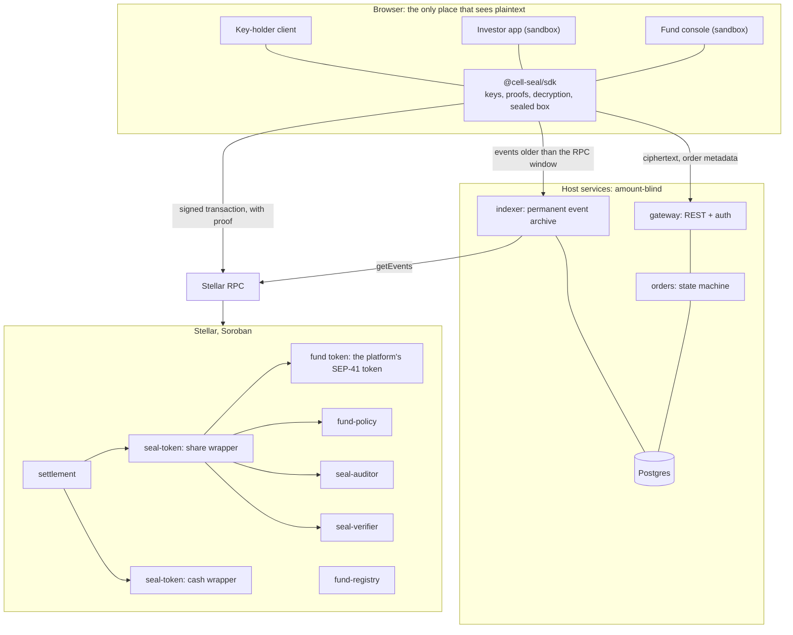
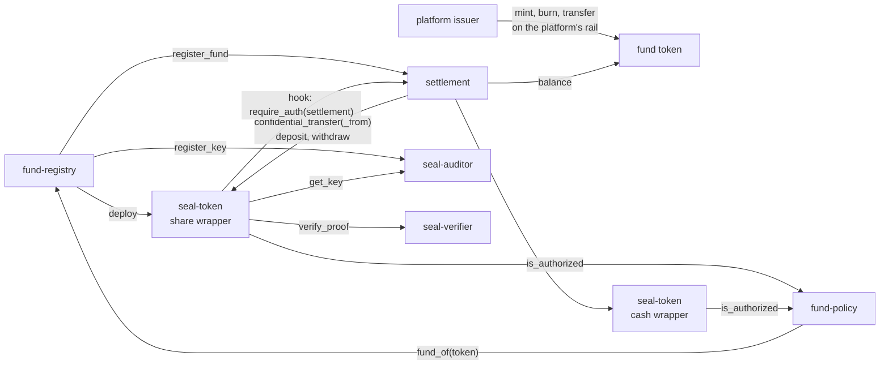
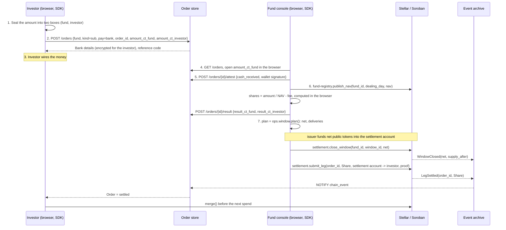

# Cell Seal Technical Architecture

| | |
|---|---|
| Version | 1.1, 2026-11-09 |
| Status | Design complete. Prototype on Stellar testnet: five of the six contracts, one full fund cycle with real proofs on 9 October 2026. Product build starts with Tranche #1 of the SCF Build Award |
| Code | https://github.com/cellprivacy/cell |
| Design | https://docs.cellprivate.com/seal, fifteen documents, listed in section 10 |
| Contact | https://cellprivate.com |

## 1. Introduction

### 1.1 Purpose

This document explains how Cell Seal is built: the components, the Soroban contracts and how
they call each other, how an order moves through the system, the security model, where the
pieces run, and what exists today. It is the first document of the technical design. The other
fourteen go deeper on each part and are linked at the end of every section.

The roadmap, budget and team are in the SCF application and are not repeated here.

### 1.2 The problem

A unit holder in a traditional fund has a private position. Only the fund and its transfer
agent know how many units they hold and how much they put in or take out.

Tokenization removes that privacy. On Stellar today anyone can look up the address of every
holder, the balance at that address, and the size of every subscription and redemption. Token
holders have the same legal rights as traditional unit holders but not the same
confidentiality. We call this the privacy parity gap.

For retail holders, every balance is public with its history. For institutional holders, the
size and timing of large orders is public too: other traders can act on it, and a large
redemption can be read as a sign of trouble. The issuer, on the other hand, must know every
holder, so identities cannot be hidden and should not be. The amount is the one field that can
be made private without touching that obligation.

Cell Seal is the second product of the Cell privacy stack. The first, Cell Protocol, is a
private payment channel built under three SCF Instawards. Cell Seal applies the same
zero-knowledge tooling to the fund register, which has to stay on-chain.

### 1.3 What Cell Seal does

The fund's existing SEP-41 token is wrapped 1:1 into sealed balances. From then on,
subscriptions, redemptions and transfers between holders run inside the wrapper as
zero-knowledge transfers. The investor's browser builds the proof for each transfer and a
Soroban contract checks it. Holder addresses, timestamps and order references stay public.

Only one amount ever becomes public: the net of each settlement window, which the settlement
contract wraps or unwraps when the window closes.

Each transfer also carries a copy encrypted to a viewing key. That key is split 2-of-3 between
the issuer, the transfer agent and the regulator. Cell holds no share of it, so Cell cannot read
any amount.

Cell Seal is sold to the party that keeps the fund's register: a tokenization platform or a
transfer agent. That party keeps its fund token, its mint and burn rights, its KYC process and
its order lifecycle. In this document "the platform" means that party.

A fund joins in one of two cases. Case 1: a new fund with no token yet starts sealed from its
first transaction. Case 2: a fund that already has a token with public holders keeps that
token; the wrapper sits on top of it and each holder moves in by self-wrapping their balance.
Both cases use the same contracts.

### 1.4 Design rules

1. **Cell Seal cannot read any amount.** Encryption, decryption and proof generation happen only
   in the browser of someone authorised to see the number. Every backend the SDK talks to is
   blind to amounts by construction, not by access policy.
2. **The chain is the source of truth.** On-chain state in the system changes only when a final
   ledger event has been seen. Every database is a cache that can be rebuilt from the chain and
   from stored ciphertext.
3. **The settlement layer knows nothing about fund business.** The contracts have no concept of
   NAV, cut-off or dealing day. Those stay with the platform.
4. **Compose, do not rewrite.** OpenZeppelin's Confidential Token is pinned as a dependency and
   used unmodified. Cell Seal builds only what it does not provide.

### 1.5 Terms

- **Wrapper**: a `seal-token` contract that holds a SEP-41 token 1:1 and issues sealed balances
  against it. A share wrapper holds a fund token; a cash wrapper holds a stablecoin.
- **Sealed**: recorded on the ledger as a Pedersen commitment with an encrypted copy for the
  recipient and for the viewing key, never as a readable number.
- **Order**: a subscription, redemption or transfer between holders. Every order has a share leg
  and a cash leg, linked by an `order_id`. The `order_id` is the only part of an order that
  appears on-chain.
- **Strike**: the moment the NAV for a dealing day is published and pending orders are priced.
- **Settlement window**: a fixed period, weekly for example, at whose end the net of all orders
  moves between the public token and the wrapper. The window's net is the only public amount.
- **Settlement account**: the fund's own account inside the wrapper. It delivers and receives
  shares and is the counterparty of every order.
- **DoP, DvP**: delivery or payment, the two legs settle separately; delivery versus payment,
  both legs settle in one transaction.

Every term is defined in [`glossary.md`](glossary.md).

## 2. System overview

### 2.1 Diagram

Three tiers. The **browser** runs the platform's app with the SDK inside it, and is the only
place that holds a private key or sees an amount in plain text. **Stellar** runs the contracts:
one set per platform plus one wrapper per fund. The **host services** are what the SDK needs
around the chain: a Stellar RPC endpoint, a permanent archive of contract events, and a store
for order metadata and ciphertext. The platform runs these in its own infrastructure. The
sandbox backend is one implementation of them.

### 2.2 Components

**Contracts.** Six Soroban contracts: `seal-token` (the wrapper, one per fund and one per
stablecoin), `fund-policy`, `settlement`, `seal-auditor`, `seal-verifier` and `fund-registry`.
A platform deploys the set once, then adds one wrapper for each fund it onboards. Section 3.

**SDK, `@cell-seal/sdk`.** A TypeScript package the platform embeds in its apps and in its
indexer. It derives each investor's keys from a signature made with their own wallet, builds
proofs in a Web Worker, decrypts events, rebuilds the fund register and wraps every contract
call. Keys never leave the worker. The page's main thread receives decrypted amounts to display
and nothing else. This is the only code in the system that touches a private key or a plain
amount.

**Event archive.** Stellar RPC keeps events for about a week. A wallet that has lost its local
state can only rebuild its sealed balance by replaying every event that concerns it, so the
archive keeps every event of every Cell Seal contract for good, in ledger order, together with
the arguments of each call into `settlement`. The sandbox `indexer` is the reference
implementation and a platform can run it as is.

**Order store.** Keeps who placed which order, its type, time and status; the sealed boxes that
carry off-chain amounts; signed confirmations from fund operations; key envelopes; and the
messages of the viewing-key ceremony. It has no key and no amount. The sandbox `gateway` and
`orders` services implement it; a platform maps the same calls onto its own order system.

**Sandbox.** A reference tokenization platform with Cell Seal built in: the backend above, a
fund console with 11 screens and an investor app with 7 screens. A platform can run a full
weekly cycle on testnet with its own token before deciding to integrate. The sandbox is not
sold and no real fund runs on it.

### 2.3 Who sees what

| | Sees | Does not see |
|---|---|---|
| Investor | Own balance and own orders | Other investors' amounts |
| Fund operations | Every order of the fund, through the fund's own keys | The viewing key. Investors' private keys |
| Key holder (issuer, transfer agent, regulator) | Own key share. The amounts of an approved disclosure | Other holders' shares |
| Host services | Who ordered, what kind, when, status, NAV, addresses | Any amount. Any private key |
| Public ledger | Addresses, timestamps, order references, NAV, sealed supply, each window's net | Any order amount. Any balance |

If the host services are fully compromised, the attacker gets metadata and ciphertext. That is
why rule 1 is enforced with cryptography and not with access control.

### 2.4 Integration points

A platform connects to Cell Seal at four points. Everything else in its product stays as it is.

| Point | What changes on the platform side | What the SDK provides |
|---|---|---|
| Order | Orders carry an `order_id` and never an amount. The amount travels as a sealed box | `createSubscription`, `createRedemption`, the sealed box |
| Register | Balances are no longer read from the token. The register is rebuilt from decrypted data in the fund's browser | `register.build()` |
| Settlement | At strike the platform computes payouts from NAV as before, then calls the SDK to deliver shares or settle DvP. At window close: fund the public net into the settlement account, call `close_window` | `window.plan()`, `window.close()` |
| Supply | The issuer still mints and burns on its own rail. `settlement` only wraps or unwraps the net | The net figure and the reconciliation checks |

Component design in full: [`architecture.md`](architecture.md). Product boundary and what the
platform owns: [`integration.md`](integration.md).

## 3. Stellar integration

### 3.1 How Stellar is used

- **Soroban contracts and authorization.** Six contracts in Rust. Nested authorization lets the
  wrapper check, inside a hook, that the call came through `settlement`.
- **SEP-41 and the Stellar Asset Contract.** The fund token is any SEP-41 token: a classic asset
  through its SAC, or a Soroban token. The wrapper calls `transfer` and `balance` on it and
  nothing else, so a fund already issued on Stellar does not reissue.
- **BN254 and Poseidon host functions, Protocols 25 and 26 (X-Ray).** They make UltraHonk proof
  verification affordable on-chain: 90 to 97 million instructions per proof against a limit of
  400 million. Two proofs fit in one transaction, which an atomic DvP needs.
- **On-chain UltraHonk verification of Noir proofs.** Through Nethermind's `rs-soroban-ultrahonk`
  verifier and OpenZeppelin's Confidential Token circuits.
- **Atomic invocations.** One call into `settlement` that runs two confidential transfers either
  completes both or neither. This gives DvP without a new circuit.
- **Stellar RPC, Soroban contract clients, Freighter with SEP-53 message signing.** The SDK
  derives the investor's privacy key from one wallet signature. No separate seed phrase.
- **Finality.** A ledger is final when it closes, so order state can advance on the first event.

### 3.2 Contracts

| Contract | Deployed | Does | Based on |
|---|---|---|---|
| Fund token | Per fund, by the platform | The fund's SEP-41 token. The issuer mints and burns it | Platform |
| `seal-token` | Per fund (share wrapper), per stablecoin (cash wrapper) | Holds the token 1:1 and keeps sealed balances. Implements the OpenZeppelin `ConfidentialToken`, `ConfidentialCompliance` and `ConfidentialClawback` traits. `SealHooks` add Cell Seal's rules | OpenZeppelin traits |
| `seal-verifier` | Per platform | Verifies UltraHonk proofs against one verification key per circuit. Key changes go through a timelock | Nethermind verifier |
| `seal-auditor` | Per platform | Registry of viewing keys, one `auditor_id` per fund | OpenZeppelin trait |
| `fund-policy` | Per platform | Whitelist and KYC expiry per fund. Answers `is_authorized(account, token)` for the sender and the receiver of every transfer without seeing the amount | Cell Seal |
| `settlement` | Per platform | The only path for a sealed transfer. Binds each transfer to an `order_id`, settles DvP atomically, wraps or unwraps the net at window close. Never mints or burns | Cell Seal |
| `fund-registry` | Per platform | Public record of each fund: terms, NAV per dealing day, roles. Deploys the wrapper when a fund is created | Cell Seal |

OpenZeppelin code is pinned to commit `5ffda91` of branch `v0.9.0` of `stellar-contracts`. In the
testnet prototype, `fund-registry` is not yet a separate contract: `register_fund` is a function
of `settlement` and of `fund-policy`. Tranche #1 splits it out (section 9).

### 3.3 What each contract does

**`seal-token`** keeps the primitive's interface: `register`, `deposit`, `withdraw`, `merge`,
`confidential_transfer`, `confidential_transfer_from`, `set_spender`, `revoke_spender`, and
`freeze`, `unfreeze`, `clawback` for the compliance operator. The primitive has one extension
point, a `Hooks` trait called after authentication and payload decryption and before storage is
written. `SealHooks` uses it for five rules. A hook never receives the amount.

- `on_register`: the account's `auditor_id` must be the fund's. Otherwise an investor could pick
  a viewing key the fund cannot read.
- `on_deposit`: `from` equals `to`, and `to` passes the policy. A deposit has a public amount, so
  nobody deposits on another account's behalf.
- `on_withdraw`, share wrapper: only the settlement account, only through `settlement`.
  Investors never unwrap shares. Shares leave the wrapper only as a window's net.
- `on_transfer`, `on_spender_transfer`: `settlement.require_auth()` must pass. Every transfer
  carries an order reference, and the settlement account cannot pull an allowance outside a DvP.
- `on_set_spender`: the spender must be a settlement account.

**`settlement`** has six functions. `register_fund` is called by `fund-registry` when a fund is
created. `submit_leg(fund_id, order_id, role, leg)` runs one sealed transfer with the settlement
account at one end and records that `(order_id, role)` has settled. `settle_dvp(fund_id,
order_id, pull, pay)` runs a `confidential_transfer_from` against the investor's allowance and a
`confidential_transfer` back, in one invocation, signed by the settlement account alone.
`settle_pair(fund_id, order_id, a, b)` runs two transfers between two investors in two tokens,
each signing one authorization entry. `close_window(fund_id, window_id, net, withdraw_data)`
refuses to run before the scheduled close, checks that the settlement account holds exactly
`net` public tokens when `net > 0`, moves `net` between the settlement account and the wrapper,
enforces the supply cap, and emits `WindowClosed(net, supply_after)`. It needs two signatures:
the issuer admin and the settlement account. `set_pilot_cap` is reserved to the platform admin.

**`fund-policy`** stores one entry per `(fund, account)`: status and KYC expiry. An account is
authorised on a share wrapper if it is the fund's settlement account, or an `Approved` investor
whose `kyc_expiry` has not passed. On a cash wrapper, if it is a settlement account of any fund
or approved in at least one fund. `set_investor` needs the fund's `Compliance` role. The policy
stores an address and an expiry date and nothing else; identity documents stay with the platform
or its KYC provider.

**`fund-registry`** creates a fund in one invocation: deploys the share wrapper from the pinned
wasm hash, registers the fund's viewing key in `seal-auditor`, opens window 1 in `settlement`,
stores the public fund record and grants the issuer admin every fund role. `publish_nav(fund_id,
dealing_day, nav)` puts one NAV per dealing day on-chain under the `NavPublisher` role, so
investors read the price from the chain and every price has a ledger anchor.

**`seal-verifier`** and **`seal-auditor`** are the primitive's traits with access control. The
platform admin writes verification keys; an update is two calls separated by `timelock_ledgers`
(default 17,280, about 24 hours). `fund-registry` registers viewing keys; the fund's issuer admin
rotates them.

Signatures, storage, events, error codes 4000 to 4505 and the permission matrix:
[`contracts.md`](contracts.md).

### 3.4 How the contracts call each other

A sealed transfer always enters through `settlement`, which calls the wrapper. The wrapper
verifies the proof with `seal-verifier`, checks both parties with `fund-policy`, reads the fund's
viewing key from `seal-auditor` to validate the auditor ciphertext, and runs `SealHooks`, which
confirms the caller is `settlement`. The wrapper touches the fund token only inside `deposit` and
`withdraw`. `settlement` reads the fund token's `balance` to check that the issuer has funded the
window before wrapping it.

`settlement.require_auth()` inside a wrapper hook passes only when `settlement` is the contract
calling the wrapper. A direct call to the wrapper fails even if the sender signed. Confirmed on
testnet.

### 3.5 What is on-chain and what is not

| Data | On-chain | Off-chain | Why |
|---|---|---|---|
| Amounts and balances | Commitment plus ciphertext for recipient and viewing key, in the wrapper | The opening (value, blinding) in the holder's wallet, encrypted in IndexedDB | The chain checks conservation without reading the number. The holder needs the opening to spend |
| `order_id` | In `settlement` events | Joined to metadata in the order store | The only public element of an order |
| Amount of a bank-transfer order, payout, bank details | Never | Sealed box to the fund's and the investor's box keys | Fund operations must read it. The backend must not |
| NAV, fund terms, roles | `fund-registry` | Cached | Public by nature. The price has a ledger anchor |
| Window net and sealed supply | `WindowClosed` event | Cached | The one public aggregate per window |
| Investor status and KYC expiry | `fund-policy` | The platform's KYC system | The wrapper checks policy without a backend |
| Order status and ownership | No | Order store | Business metadata the contracts do not need |
| Event history | RPC, about 7 days | Permanent archive | Wallets recover by replaying events |
| Private keys, roots, key shares | Never | Browser memory. Encrypted envelopes for backup | Rule 1 |

### 3.6 Tokens, accounts and keys on Stellar

Fund tokens with `AUTH_REQUIRED` work: the issuer authorises the wrapper and the settlement
account before the first deposit. `AUTH_CLAWBACK_ENABLED` needs a written commitment from the
issuer not to claw back the wrapper, because the wrapper's pool backs every sealed balance. SEP-8
regulated assets are not supported in the sealed layer: a transfer invoked by a contract does not
pass the SEP-8 approval server.

Cell Seal is non-custodial. The wrapper holds the pooled token. Investors hold their own Stellar
key and their own privacy key. Cell holds nothing.

The investor's privacy key comes from one SEP-53 signature over a message that names the wrapper
and the account, so a signature obtained by deception unlocks nothing else. The SDK asks for the
signature twice and compares; a wallet that signs non-deterministically (MPC or threshold
wallets) gets a random root with a mandatory backup instead.

A fund operates four kinds of account: the issuer admin (a multisig that co-signs every window
close), the settlement account (a fund account whose signers are operations staff), personal
accounts of operations staff, and the key holders' accounts. The settlement account has several
operators who change over time, so its privacy key is not derived from a signer. It comes from a
32-byte `ops_root` generated when the fund is created and handed to authorised staff as encrypted
envelopes. Moving shares from the settlement account needs both a proof (which needs `ops_root`)
and the account's signature (which needs signer weight). Exposing either alone moves nothing.

The platform admin is a 2-of-3 multisig on hardware wallets. Every upgrade and every
verification-key change goes through the on-chain timelock.

### 3.7 Cost and limits measured on testnet

Stellar testnet, protocol 29, 9 October 2026. Real UltraHonk proofs, Nethermind verifier.

| Call | Proof | Instructions | Fee | Footprint read / write |
|---|---|---|---|---|
| `register` | register | 89,087,248 | 0.095 XLM | 11 / 1 |
| `close_window`, net > 0 | none | 17,770,000 | 0.403 XLM, mostly rent for new entries | |
| `submit_leg` through `settlement` | transfer | 93,905,795 | 0.165 XLM | 17 / 3 |
| `close_window`, net < 0 | withdraw | 96,637,602 | 0.129 XLM | 18 / 6 |
| `settle_dvp`, `settle_pair` | two transfers | about 188,000,000 | | inside the 400,000,000 limit |

Every proof is 14,592 bytes. Building one takes about 1 second on a laptop and 2.7 to 6.7
seconds on a 4 GB phone with multithreading. Amounts are `i128` with 7 decimals; NAV is `i128`
at scale 10^7. The six verification keys rebuild byte-identical with nargo `1.0.0-beta.11` and
bb `0.87.0`.

### 3.8 State lifetime and upgrades

Sealed accounts, spender delegations, fund records, window state, policy entries and the
`Settled(order_id, role)` replay guard are persistent storage. A host job extends their TTL
before expiry for every account active in the last 90 days. The platform pays the rent and
prices it into its service. An expired entry can be restored for the restore fee; nothing is
lost. Verification keys are instance storage and are bumped with the contract.

`settlement`, `fund-policy` and `fund-registry` are upgraded by the platform admin behind the
timelock. A fund's wrapper is upgraded by that fund's issuer admin. The wrapper address is an
input to every holder's key derivation, so a wrapper is upgraded in place and never redeployed.

Primitive survey and measurements: [`primitives.md`](primitives.md). Cryptography:
[`cryptography.md`](cryptography.md).

## 4. How an order flows

### 4.1 Orders, legs and modes

Every order has a share leg and a cash leg. The share leg is always on-chain, inside the share
wrapper, sealed. The cash leg is either a bank transfer, confirmed by a signed attestation from
fund operations, or a sealed stablecoin transfer inside a cash wrapper. Each leg has its own
state; the order is done when both are confirmed.

Funds price forward, so an order is placed before the price is known. Three moments are kept
apart. At **placement** the order is recorded and, where needed, the investor's sealed funds are
escrowed. At **strike** the NAV goes on-chain and every pending order is priced in the fund's
browser. At **settlement**, when the window closes, the issuer funds the net, `close_window`
wraps it, and shares are delivered.

How the legs settle depends on how the investor pays. Bank transfer: the share leg settles
on-chain once the issuer confirms the payment (DoP). Stablecoin: both legs settle in the same
transaction (DvP). DvP is mandatory for transfers between holders.

### 4.2 Subscription paid by bank transfer

1. **Placement.** The investor enters the amount. The SDK puts the amount, currency and
   `order_id` into an `OrderSecret`, pads every number to a fixed length, and seals it twice with
   libsodium `crypto_box_seal`: to the fund's box key and to the investor's own. It posts the
   metadata and both ciphertexts to the order store. Nothing goes on-chain.
2. **Payment.** The order store returns the fund's bank details, encrypted for the investor, and
   a reference code that contains only the order code. The investor wires the money.
3. **Confirmation.** Fund operations open the fund's copy in the browser, match the incoming
   payment, and sign `{order_id, cash_received, time}` with their wallet. The order store checks
   the signature and the signer's on-chain role and stores the attestation as received. The cash
   leg is confirmed.
4. **Strike.** On the dealing day, fund operations publish the NAV through `fund-registry`. The
   SDK computes `shares = amount / NAV − fee` for every order, in integers with one rounding
   rule, seals the result to the fund and to the investor, and posts both.
5. **Settlement.** When the window is due, `ops.window.plan()` returns the net of all orders.
   The issuer mints (Case 1) or transfers (Case 2) exactly `net` public tokens into the
   settlement account. The SDK checks that the account holds exactly `net`, then calls
   `close_window`, which deposits `net` into the wrapper and emits `WindowClosed`. The SDK then
   calls `submit_leg` once per subscription, each with a fresh proof, and sealed shares move from
   the settlement account to each investor.
6. **Done.** The archive records `LegSettled(order_id, Share)` and notifies the order store,
   which marks the order settled. The investor's SDK sees the transfer, decrypts the amount with
   the viewing key, and calls `merge` before the next spend.

What the ledger shows for this order: a NAV, one public transfer of `net` into the settlement
account, one `deposit` of `net`, and one sealed transfer from the settlement account to the
investor. Never the amount the investor subscribed.

### 4.3 Stablecoin orders and transfers between holders

A **redemption paid by bank transfer** starts with the investor calling `submit_leg` at placement
to send sealed shares to the settlement account. The settlement account is the recipient and
decrypts the amount itself. After strike, fund operations pay out and attest `cash_paid`. The
shares stay in the settlement account and are netted at window close.

A **subscription or redemption in stablecoin** escrows the investor's side at placement with
`set_spender` on the relevant wrapper, naming the settlement account as spender. At settlement,
`settle_dvp` pulls the escrowed leg and pays the other in one invocation. The investor does not
have to be online. The escrow is separate from the spendable balance, so the investor can keep
transacting without breaking the pending order.

A **transfer between two holders** uses `settle_pair`. Each side builds the proof for its own leg,
decrypts the leg it will receive to check the agreed amount, and signs one authorization entry.
The transaction runs both transfers or neither. The receiver then sends the opening of its leg to
the fund, encrypted to the fund's box key, so the register updates without the viewing key.

### 4.4 Disclosure

A disclosure request names the reader, the scope and an expiry. Two of the three key holders
each compute a partial decryption for every event in scope, with a proof of correctness (DLEQ),
inside their own client. The reader combines the partials, decrypts, checks each opening against
its on-chain commitment, and gets exactly the approved scope. Every opening is written to a
hash-chained log. A single holder cannot open anything.

### 4.5 When something fails

| Failure | Detected by | What happens |
|---|---|---|
| Payment never arrives | The order stays in `awaiting_cash`; the age of the oldest such order is monitored | Fund operations hold, reject or cancel. No share has moved |
| Forged attestation | The order store checks the wallet signature and the on-chain `fund_ops:signer` role | Rejected on write. A compromised backend cannot produce one |
| Window closed early or without funds | `close_window` reverts with `WindowNotDue` or `NetNotFunded`. The SDK stops earlier with `E_WINDOW_NOT_DUE`, `E_NET_NOT_FUNDED` or `E_NET_OVERFUNDED` | The issuer funds exactly `net` and retries. A surplus is refused because it reveals the next period |
| A delivery fails mid-window | Each proof depends on the previous one through the settlement account's commitment, so the SDK stops, resyncs and rebuilds the remaining proofs | `Settled(order_id, role)` stops a retry from delivering twice |
| Client claims a transaction went through | No API changes on-chain leg state; only an archived event does | The UI shows the order as confirming until the archive has the event |
| Archive falls behind RPC retention | Alert at 25% of the retention window used | Backfill from Horizon or an archive node. New on-chain orders pause |
| Wallet state differs from the chain | The SDK checks the rebuilt opening against the on-chain commitment after every sync | `E_STATE_DIVERGED`: rebuild from the last checkpoint. No proof until they match |
| On-chain verification key differs from the pinned one | `E_VK_MISMATCH` on connect | Proving is blocked. The timelock leaves time to investigate |

Flows in full: [`flows.md`](flows.md). SDK calls: [`sdk.md`](sdk.md). Order state machine and
API: [`backend.md`](backend.md).

## 5. Security

### 5.1 What is protected, and from whom

In order of importance: the confidentiality of amounts (A1); the integrity of shares, so none
is created, destroyed or misdirected (A2); the ability of the fund and the regulator to read
(A3); the ability of each investor to spend (A4); order metadata (A5).

| Adversary | Has | Gets |
|---|---|---|
| Chain observer | All public data, forever, with analysis tools | Who the investors are, how often each address transacts, NAV, each window's net. No order amount, no balance. Residual exposure: a window with very few orders; a stablecoin top-up sized like an order |
| Malicious investor | A valid account, arbitrary proofs | Nothing. Overspend, negative amounts and replayed proofs fail in the circuits and in the binding of each proof to the current balance commitment. Withholding an opening after a transfer delays the register until the next reconciliation |
| Backend attacker | Full read and write on the order store and archive | Metadata and ciphertext. Cannot change on-chain leg state, forge an attestation, or swap a box key: the client checks the wallet signature on every box key and the fund's is anchored on-chain |
| Cell insider | Release rights on the SDK package and the contract wasm | Could plant key-stealing code in a web build. This is the largest residual risk of a web product. Countered by reproducible builds, published hashes, platforms building from source, strict CSP and no third-party scripts |
| Malicious fund operations staff | The `signer` role of one fund | Can read that fund's orders. Cannot move assets without the settlement account's signer weight, cannot pull an allowance without paying, and every action is on-chain and in the audit log |
| Malicious key holder | One viewing-key share | Nothing alone. Two colluding holders read everything in that key epoch. That is the chosen trust model, and the reason shares sit with independent legal entities |
| Upstream defect | A bug in the circuits, verifier or primitive | Could break A1 or A2. Covered by the supply cap and the audit conditions in 5.9 |

Fraud by an issuer through off-chain channels, a bank transfer that never arrives or a wrong NAV,
is out of scope. Cell Seal keeps the evidence for a dispute; it cannot stop the behaviour.

Tranche #2 extends this into a STRIDE threat model of the wrapper, verifier, policy, settlement,
registry, auditor, SDK, indexer and sandbox backend, with every threat mapped to a monitor in
5.8 or to a note on why it cannot be watched on-chain.

### 5.2 Keys

| Key | Type | Lives in | How it is made and recovered |
|---|---|---|---|
| Stellar key | ed25519 | The user's wallet. Platform admin keys on hardware wallets | The wallet's own backup |
| Privacy key (`sk`, `vk`) | Grumpkin | Web Worker memory, wiped after 15 minutes idle. Never on the main thread | HKDF-SHA-512 over a SEP-53 signature naming the wrapper and the account. Re-derived each session; the signature is never stored. Non-deterministic wallets get a random root with a mandatory backup |
| Ops root | 32 random bytes | Browsers of authorised operations staff, as sealed envelopes | Generated once per fund. Root of the settlement account's privacy keys and of the fund's box key. Exposure allows reading, not moving |
| Box key | X25519 | Derived per session for users; from `ops_root` for a fund | Sealed boxes for off-chain data, separate from the primitive's cryptography |
| Viewing-key share | Grumpkin scalar | Key-holder client memory; one sealed backup envelope | Distributed key generation at fund creation, 2-of-3. The full key never exists in one place, except during a clawback ceremony |
| Platform admin key | ed25519 multisig | Hardware wallets | Every use passes the on-chain timelock |
| Session token | JWT, 15 minutes | Browser | Issued against a wallet-signed challenge. Carries no key and no amount |

No backend holds a private key, a root or a plain amount at any time. Rotation and loss
procedures: [`keys.md`](keys.md).

### 5.3 Who can do what

| Operation | Platform admin | Issuer admin | Settlement account | Fund operations | Investor |
|---|---|---|---|---|---|
| Deploy and upgrade platform contracts | multisig + timelock | | | | |
| Write verification keys | timelock | | | | |
| Create fund, update terms, grant and revoke roles | | yes | | | |
| Set supply cap | yes | | | | |
| Rotate the fund's viewing key | | yes | | | |
| Freeze, clawback | | yes | | | |
| Close window | | co-signs | co-signs | | |
| Mint and burn the fund token | | on the platform's rail | | | |
| Settle DvP, deliver subscription shares | | | signs | operates | |
| Set investor status, publish NAV | | | | by on-chain role | |
| Register, submit leg, set and revoke spender, merge | | | | | yes |
| Settle pair | | | | | both parties |

Admin functions check `require_auth` on the admin address and the role in
`fund-registry.has_role`. Fund roles live on-chain. The order store caches them and drops API
access when the archive sees `RoleRevoked`.

### 5.4 Input checks

- Every proof is verified on-chain against a key the platform admin registered. The circuits
  enforce `0 ≤ v < 2^127`, conservation of value, and binding to the sender's current balance
  commitment, so a replayed proof fails.
- `settlement` rejects a leg of the wrong shape: wrong direction, token not in the fund,
  settlement account missing where required, same token on both legs of a DvP. Each
  `(order_id, role)` settles once.
- `SealHooks` reject a foreign `auditor_id`, a deposit to another account, a withdrawal by an
  investor, a transfer that did not come through `settlement`, and a delegation to anything but
  a settlement account.
- `fund-policy` runs for both parties of every operation and fails at once for a suspended or
  removed investor.
- The order store checks the length and format of each sealed box and nothing else, because it
  cannot. The client checks that the `order_id` inside the plaintext matches the order it came
  with. Numbers are padded, so ciphertext length says nothing.
- Apps hold amounts as `bigint` at scale 10^7, accept at most 7 decimal places, and round down
  with one rule shared with the future price-linking circuit.
- Every write to the order store carries an idempotency key. The schema has no column for an
  amount other than public NAV and window net, and a CI test scans the schema and sample logs to
  keep it that way.

### 5.5 Where an amount could leak, and what stops it

The design lists 18 ways an amount could be inferred from public data (L1 to L18 in
[`security.md`](security.md)), each with the control that blocks it. The main ones:

- A payout in a public stablecoin gives the share count as `payout / NAV`. The on-chain cash leg
  always settles inside a sealed cash wrapper.
- An investor unwrapping shares publishes the amount. Only the settlement account can unwrap,
  through `settlement`. A redemption is a sealed transfer, never an unwrap.
- An unwrap right after a large order can be matched to it. `close_window` cannot run before the
  scheduled close, so the net is published on a schedule, not on demand.
- A window with one order publishes that order as the net. The fund console shows how many
  orders cover the net before closing, and the window length is set per fund.
- A fee paid as a separate transfer gives the order size as `fee / rate`. Fees are taken inside
  the priced result. There is no separate fee transfer.
- A sealed box grows with the number inside. Numbers are padded to a fixed length.
- Funding the settlement account with more than `net` shows that the next period has
  subscriptions. The SDK refuses to close unless the public balance equals `net`.
- In Case 2, minting public shares to an investor who then self-wraps ties a public amount to an
  address. New shares for a sealed investor always go from the settlement account inside the
  wrapper. The indexer flags a self-wrap that follows a public transfer from the issuer.

Wrap and unwrap amounts are public in the primitive. The design accepts this and limits them to
the per-window net. That is what the settlement window is for.

### 5.6 Compliance controls

Cell Seal hides amounts and nothing else. Holder addresses, timing and transaction type stay on
the public ledger.

- KYC expiry and whitelist checks on the sender and the receiver of every transfer, including
  the first wrap.
- Unwraps limited to the fund's settlement account.
- A 2-of-3 viewing key held by the issuer, the transfer agent and the regulator, with no share
  for Cell.
- Two-party approval and a hash-chained log for every disclosure.
- No identity data in the circuits or anywhere in Cell systems. The policy contract stores an
  address and an expiry date; identity documents stay with the platform or its KYC provider.
- Freeze and clawback through the primitive, for the issuer admin, under a written procedure.

Reentrancy does not exist on Soroban. There is no pooled liquidity, so flash-loan attacks do not
apply. The NAV is an oracle-like input published by the fund under an on-chain role; the first
release does not enforce the price relation between the two legs in the contract, so a wrong NAV
is detectable from the investor's decrypted leg and the ledger anchor, not prevented. The
wrapper is a pooled custody point: a token issuer that freezes or claws back the wrapper affects
every holder in it, which is why the onboarding checklist requires a no-clawback commitment for
the fund token and a review of the stablecoin issuer's policy.

### 5.7 Invariants

Enforced by the contracts and checked by the archive, with the enforcement point for each in
[`contracts.md`](contracts.md) section 9 and [`security.md`](security.md) section 4:

- The wrapper's token balance changes only at `close_window`, by exactly `net`, or by a holder's
  self-wrap. After every close it equals the sealed supply in `WindowClosed`.
- The sum of sealed claims in a wrapper equals the token balance the wrapper holds.
- No sealed transfer happens outside `settlement`. Each `(order_id, role)` settles once.
- Every account in a fund's share wrapper carries that fund's `auditor_id`.
- An allowance can only be granted to a settlement account.
- No Cell Seal contract receives a plain amount other than the `net` of `close_window`.
- No backend process ever holds a plain amount, a private key or a root.
- The page's main thread never receives a private key, a root or a key share.
- Every use of the viewing key matches an approved disclosure request and a line in the log.

### 5.8 On-chain monitoring plan

Each monitor reads events the contracts already emit, or the host services. Each has a trigger,
an owner and a runbook; the runbooks are written in Tranche #2 and exercised in a recorded
testnet drill with four injected faults: a failed proof check, a broken invariant, an underfunded
close and indexer lag.

| Monitor | Reads | Triggers when | Response |
|---|---|---|---|
| Wrapper balance equals sealed supply | `WindowClosed.supply_after` against the token's `balance(wrapper)` | Any difference | Highest severity. Stop `close_window`, reconcile, tell the fund |
| Settlement account holds exactly the net at close | Fund token events around `WindowClosed` | Funding not equal to `net` before, or recall not equal to `|net|` after | Highest severity. Supply discipline broken |
| Wrapper deposit or withdraw outside `close_window` that is not a self-wrap | Wrapper events | Any | Highest severity. Investigate the wrapper admin key |
| Key, admin or policy change during its timelock | `seal-verifier`, `seal-auditor`, `fund-registry` events | Any change outside the release calendar | SDK stops proving. Investigate the admin key during the delay |
| Failed proof checks, repeated `order_id` | Contract errors from `seal-verifier` and `settlement` | Rise above baseline, or any repeat | Investigate the sender. Possible attack or SDK defect |
| Self-wrap right after a public transfer from the issuer | Wrapper and fund token events | Same address, short interval | Warn the platform: a public amount tied to an address |
| Window with too few orders to hide sizes | Order store, before close | Below the fund's cover threshold | Fund console warns before closing |
| Indexer lag against RPC retention | Archive status against the latest ledger | Above 25% of the retention window | Alert, backfill, pause new on-chain orders |
| Window past its close and not closed | Scheduler | Any | Notify fund operations |
| Any amount-like value in a request, URL, header or log | Network scan and log scan in CI | Any | Build fails |

Reported from mainnet contract events at launch and every month after: funds onboarded through
`fund-registry`, sealed transfers verified, settlement windows closed, sealed supply against the
cap, share of proofs that fail verification, disclosure openings logged. Individual amounts are
never reported.

### 5.9 Audit and mainnet conditions

Tests from the integration level up run against the real verifier with real proofs on a local
network. Mock verifiers are not used, because a passing test with a fake verifier says nothing.

Before mainnet, two external reviews: an independent cryptographic review of the six parts Cell
Seal designed itself (the sealed box format, the DvP protocol, distributed key generation and
threshold decryption, the clawback ceremony, register openings, key derivation), and an external
audit of `settlement`, `fund-policy`, `fund-registry` and `SealHooks`. The audit is paid through
SCF audit credits, not the award budget, and the Soroban Audit Bank application is prepared with
the release freeze.

Cell Seal launches on mainnet only after that audit is finished. If the audit is not finished by
the milestone date, the frozen, reproducible release is delivered ready to deploy and nothing
unaudited goes to mainnet. At launch every fund runs under a supply cap enforced by `settlement`.
The cap stays until OpenZeppelin's verifier has also been audited. The open question of the
non-zk proof flavour (section 9.3) is tracked with upstream in the same period.

Incident runbooks for a suspected soundness defect, an `ops_root` compromise, a backend
compromise, a tampered web build, lost events and an unplanned key change:
[`security.md`](security.md) section 8.

## 6. Infrastructure

### 6.1 Where things run

The contracts run on Stellar. Each platform deploys its own set from the published wasm hashes
with its own admin key. Cell operates no contract for a real fund. The SDK is installed from npm
into the platform's apps and carries the circuit artifacts pinned by hash, which it compares with
the keys in `seal-verifier` at start-up.

The host services run in the platform's infrastructure. The reference implementation runs under
Docker Compose: `gateway`, `indexer`, `jobs`, Postgres 16, and the two web apps as static
builds. `indexer` is a separate process so archiving continues while the gateway is redeployed.
Cell hosts one sandbox on testnet for evaluation.

The web apps are served with `Cross-Origin-Opener-Policy: same-origin` and
`Cross-Origin-Embedder-Policy: require-corp`, which multithreaded proving needs and which also
block third-party embeds. The Content Security Policy allows scripts and WebAssembly from the
app's origin only, and connections to the API, RPC and archive only. No analytics, no session
recorders, no fonts or scripts from a CDN. Error reports pass a filter that strips every numeric
field. Each release publishes its bundle hash.

### 6.2 RPC and event retention

| Environment | RPC | Note |
|---|---|---|
| `local` | Stellar Quickstart container | Real verifier and real proofs in development and CI |
| `testnet` | Public SDF RPC for development; a dedicated provider for the hosted sandbox | The archive must stay inside the retention window |
| Mainnet | A dedicated provider with a second as failover, run by the platform. Horizon or an archive node for backfill | RPC keeps about 7 days of events; the archive is the durable store |

The SDK takes one URL per host service and joins the RPC event tail onto the archived history,
so apps never depend on RPC retention.

### 6.3 Environments and release gates

| Environment | Network | Used for | Gate to the next |
|---|---|---|---|
| `local` | Quickstart | Development, CI | Tests pass with the real verifier |
| `testnet` | Testnet | Integration, hosted sandbox, pilot with a sample or partner fund | A full window with at least three subscriptions and two redemptions in which only `net` is public, and the register rebuilt in the browser equals the wrapper balance ([`onboarding.md`](onboarding.md) section 7) |
| Mainnet, capped | Mainnet | Pilot under the per-fund supply cap | Contract audit finished; cryptographic review finished |
| Mainnet | Mainnet | Cap lifted with `set_pilot_cap` | OpenZeppelin's verifier audited |

### 6.4 Rollback

A contract release that proves faulty is withdrawn during its timelock. A tampered web build is
replaced with the hash-verified build and every key used during the exposure is treated as
compromised. A fund is paused by freezing its accounts and halting `close_window`. Logs are
structured JSON with ciphertext fields never written; Postgres runs with point-in-time recovery
for the data that cannot be rebuilt from the chain: ciphertext, attestations, envelopes and the
audit log.

Deployment detail: [`architecture.md`](architecture.md) section 9, [`backend.md`](backend.md)
section 8, [`frontend.md`](frontend.md) section 8.

## 7. Technology stack

| Layer | Technology | Note |
|---|---|---|
| Contracts | Rust, Soroban SDK, target `wasm32v1-none`. OpenZeppelin `stellar-contracts` `v0.9.0` at `5ffda91`. Nethermind `rs-soroban-ultrahonk` | One crate per contract |
| Circuits | Noir, UltraHonk, Aztec Ignition SRS. nargo `1.0.0-beta.11`, bb `0.87.0` | The six upstream circuits, unmodified. Keys rebuild byte-identical |
| Cryptography in the SDK | Grumpkin, Pedersen commitments, Poseidon2, ECDH one-time pad (primitive). X25519 + XSalsa20-Poly1305 sealed boxes via libsodium. Pedersen DKG, Chaum-Pedersen DLEQ, Lagrange interpolation (viewing key) | Cell's own constructions go to the cryptographic review |
| SDK | TypeScript. bb.js (WebAssembly) in a Web Worker. Layers `core`, `keys`, `prover`, `wallet`, `token` implement the upstream spec; `box`, `threshold`, `seal`, `rpc` are Cell Seal's | `@cell-seal/sdk` on npm |
| Sandbox backend | Rust: axum 0.8, sqlx 0.8, tokio. Postgres 16 | `gateway`, `auth`, `orders`, `indexer`, `jobs`, `core` |
| Sandbox apps | Vite, React 19, TypeScript, Tailwind 4, TanStack Query. Vitest, Testing Library, Playwright | Fund console, investor app, two origins |
| Wallet and session | Freighter or any SEP-53 wallet. Wallet-signed challenge, JWT of 15 minutes | No passwords, no e-mail identifiers |
| Chain access | Stellar RPC. Horizon or an archive node for backfill | Permanent archive in Postgres |
| Testing | `cargo test`, `proptest`, `cargo-fuzz`. Real proofs on the local network. Schema, log and network scans | No mock verifier above unit level |
| Delivery | Docker Compose. `stellar` CLI 27.1. Static hosting with COOP, COEP and CSP | |

## 8. Open source and licensing

The six settlement contracts are open source, so anyone can read, audit and verify what runs
on-chain. Each release publishes the wasm hashes that platforms deploy, so the deployed code can
be compared with the published build. The `core` and `token` layers of the SDK, which implement
OpenZeppelin's SDK specification for the Confidential Token and work with any contract built on
the primitive, are open source under Apache-2.0 and are published first.

Platforms pay for the Cell Seal package: a yearly deployment licence per platform at 1 to 3
basis points of the fund assets it seals; the production package, which is the SDK's settlement,
disclosure and register modules, the reference indexer and the onboarding tooling; and a one-time
onboarding fee followed by support and upgrades that track Stellar protocol and OpenZeppelin
releases. The sandbox is part of the evaluation and is not sold.

This design, the fifteen documents in section 10, is published at docs.cellprivate.com/seal.

## 9. Status and plan

### 9.1 What exists today

The team built the Cell Seal prototype with its own funds. On 9 October 2026 it ran a full cycle
on Stellar testnet with real proofs: the settlement account and an investor registered on the
wrapper, `close_window` with a net of +1,000 shares, 250 shares delivered sealed to the
investor, 100 shares redeemed sealed with an `order_id`, and `close_window` with a net of −100
shares and a withdraw proof. The ledger shows two sealed transfers between known addresses and
two public numbers, +1,000 and −100. It never shows 250 or 100. Contract IDs and every
transaction hash are in Appendix A.

The prototype has five of the six product contracts, with `settlement` in a minimal form. Two
things differ from the design in sections 3 and 4:

- `fund-registry` is not a separate contract yet. `register_fund` lives in `settlement` and in
  `fund-policy`. Tranche #1 splits it out so a platform can register a fund on a token it already
  issued.
- `settlement` still mints and burns the fund token when a window closes. Tranche #1 changes it
  to wrap or unwrap only the net, and the issuer mints and burns on its own rail.

The six verification keys are registered in `seal-verifier` and rebuild byte-identical. The SDK,
the sandbox backend and the two apps are designed ([`sdk.md`](sdk.md), [`backend.md`](backend.md),
[`frontend.md`](frontend.md), 18 screens in [`design/`](design/README.md)) and not yet built.

### 9.2 What the award builds

The SCF application funds the work that turns the prototype into the product. The mapping to the
parts of this document:

| Tranche | Builds | Sections |
|---|---|---|
| #1, by 31 January 2027 | Product-model contract changes (no mint or burn in `settlement`, self-wrap, `fund-registry` split out). Case 2 on a classic asset through its SAC. SDK v0: keys, prover, wallet state, clients for all six contracts. Reference indexer v0 and the window rule. Public CI with real proofs and a reviewer script | 3.2, 3.3, 3.6, 2.2, 4.1 |
| #2, by 4 April 2027 | Timelock on key and admin changes. STRIDE threat model and on-chain monitoring plan with alerts running on testnet. TTL and rent management. Cash wrapper, `settle_dvp`, `settle_pair`. Sandbox backend and apps. Integration guide v1 | 3.8, 5.1, 5.8, 4.3, 2.2, 2.4 |
| #3, by 30 May 2027 | 2-of-3 viewing key and audit access. Position limit at intake and clawback rehearsal. Release freeze and reproducible builds; Audit Bank application. Platform pilot in the sandbox. SDK 1.0 and runbooks. Mainnet launch under the supply cap after the external audit | 4.4, 5.2, 5.9, 6.3 |

### 9.3 Dependencies outside the team's control

| Dependency | State | Effect | Handling |
|---|---|---|---|
| Confidential Token on mainnet | Developer preview on testnet. One audit round done, report not published. Not in a stable release | Mainnet launch waits for it. Everything else is finished on testnet first | Commit pinned, `v0.9.0` tracked, compatibility tests rerun on every upgrade |
| `rs-soroban-ultrahonk` verifier | Not audited | A soundness defect would allow forged proofs | Supply cap until audited |
| Non-zk proof flavour | The upstream recipe does not enable `--zk`; the verifier implements only the non-zk flavour | A proof may leak information about its witness | Raised upstream. Tracked alongside the verifier audit |
| Wallet message signing | SEP-53 support is uneven; MPC wallets sign non-deterministically | The privacy key cannot be derived from the signature | Determinism check at enrolment; random-root fallback with mandatory backup |
| RPC event retention | About 7 days | A lagging archive loses events for good | Alert at 25% of the window; backfill path; permanent archive |

### 9.4 Limits of the first release

The contract does not enforce the price relation between the two legs of a DvP; the investor
checks it from the decrypted leg, and a price-linking circuit with its own verifier comes later.
Position limits are checked at order intake, off-chain; a transfer between holders that breaches
a limit is detected afterwards, not blocked. Clawback uses the primitive's public-amount
clawback through a controlled key-reconstruction ceremony; a sealed forced transfer is a later
circuit. Bank transfers are confirmed by hand by fund operations; there is no bank or ramp
integration yet.

## 10. References

| Document | Content |
|---|---|
| [`overview.md`](overview.md) | What the product does, for whom, what it does not do |
| [`glossary.md`](glossary.md) | Every term, with its name in the contracts and the SDK |
| [`flows.md`](flows.md) | Each business flow: who does what, what goes on-chain, what the market sees |
| [`integration.md`](integration.md) | Product boundary, fund token requirements, supply rules, reconciliation |
| [`onboarding.md`](onboarding.md) | Bringing a fund onto Cell Seal, Case 1 and Case 2, checks before go-live |
| [`primitives.md`](primitives.md) | The Confidential Token: what is reused, what is built, testnet measurements |
| [`architecture.md`](architecture.md) | Components, trust boundaries, data classification, data flows, deployment |
| [`contracts.md`](contracts.md) | Each contract: storage, functions, events, errors, permissions, invariants |
| [`cryptography.md`](cryptography.md) | Transfer anatomy, sealed box, DvP protocol, threshold viewing key, review scope |
| [`keys.md`](keys.md) | Every key: generation, storage, recovery, rotation, loss |
| [`sdk.md`](sdk.md) | The SDK API and the host services it needs |
| [`security.md`](security.md) | Threat model, leak catalogue, invariants, assurance plan, incident response |
| [`backend.md`](backend.md) | Sandbox backend: services, API, state machine, archive, data model |
| [`frontend.md`](frontend.md) | Sandbox apps: routes, data handling, browser security |
| [`design/`](design/README.md) | The 18 screens of the fund console and the investor app |

## Appendix A. Testnet contracts and transactions

Deployed 9 October 2026. Deployer `GDUY7EOZ…`, issuer `GBZ7KPBG…`, settlement account
`GA2EDT7M…`, investor `GD4PO2NE…`. Fund 1, auditor key 1. Every link opens on stellar.expert.

| Contract | Address |
|---|---|
| `seal-token`, share wrapper | [`CC2EM5TWSKTN5EHK43FQKPKZB2YUK35RBH26PZZUYWK4D6DXYE2XS5YF`](https://stellar.expert/explorer/testnet/contract/CC2EM5TWSKTN5EHK43FQKPKZB2YUK35RBH26PZZUYWK4D6DXYE2XS5YF) |
| `seal-verifier` | [`CBQN7SJNPWJLP7YAQFPLSUAQUIUS4ZIH2NX6CNRANAXJOYLWUQ3XYB6H`](https://stellar.expert/explorer/testnet/contract/CBQN7SJNPWJLP7YAQFPLSUAQUIUS4ZIH2NX6CNRANAXJOYLWUQ3XYB6H) |
| `seal-auditor` | [`CBHABCYD6XDWQB3NX2G6RCW625VGD26BKUWCSGUWANWTL37IT4ZYWLGA`](https://stellar.expert/explorer/testnet/contract/CBHABCYD6XDWQB3NX2G6RCW625VGD26BKUWCSGUWANWTL37IT4ZYWLGA) |
| `fund-policy` | [`CDJU4EF7MUVUHIUY7I6SXNIZENS7FEHSGQ7EQTLQTVNBP7VYT74KDUBD`](https://stellar.expert/explorer/testnet/contract/CDJU4EF7MUVUHIUY7I6SXNIZENS7FEHSGQ7EQTLQTVNBP7VYT74KDUBD) |
| `settlement` | [`CCWFND6FODZHUBK5QR3KQ2YEED5IJEUDGLWWNVPTKDHRGY5O3CY3KJSG`](https://stellar.expert/explorer/testnet/contract/CCWFND6FODZHUBK5QR3KQ2YEED5IJEUDGLWWNVPTKDHRGY5O3CY3KJSG) |
| `fund-registry` | Not a separate contract yet. `register_fund` is a function of `settlement` and of `fund-policy`, see the two transactions below |
| Sample fund token, "Meridian T-Bill Fund" (MTF), Case 1 tests only | [`CDZIHJORGZBGZGX6YD57X6PF64GHPKKMMVZO3W6M6U7L3CVYBDTDGZX6`](https://stellar.expert/explorer/testnet/contract/CDZIHJORGZBGZGX6YD57X6PF64GHPKKMMVZO3W6M6U7L3CVYBDTDGZX6) |

Verification keys registered in `seal-verifier`, one transaction per circuit:

| Circuit | Transaction |
|---|---|
| register (0) | [`528a26f6…`](https://stellar.expert/explorer/testnet/tx/528a26f6e3a7da505b44b945abe6a9792f71aa5f841f4a2f11ba0d1a66031a6a) |
| withdraw (1) | [`66ec265c…`](https://stellar.expert/explorer/testnet/tx/66ec265c406f988d7bda9923d294b7a268717fedc0b33b98bc4aa3627d59bc30) |
| transfer (2) | [`e4f2afec…`](https://stellar.expert/explorer/testnet/tx/e4f2afec08aeaaee19b9ac9e1fb54166ea8a251bafa47cf8b78c5145fe9e0452) |
| spender_transfer (3) | [`1c6773d1…`](https://stellar.expert/explorer/testnet/tx/1c6773d1e6c048d7316bd105698216919971ef4ac8c503f4e02b988636d03b11) |
| set_spender (4) | [`0b6b81de…`](https://stellar.expert/explorer/testnet/tx/0b6b81de24d73cb32efe764385a36dd316746b49492c411685a5898755844a33) |
| clawback (100) | [`eaf4cef2…`](https://stellar.expert/explorer/testnet/tx/eaf4cef2e355d3cca62e05796e73e79f24a58b2c3f02ba3c5cd07b086344e2fe) |

Fund set-up:

| Step | Transaction |
|---|---|
| Auditor key registered in `seal-auditor` | [`4751277a…`](https://stellar.expert/explorer/testnet/tx/4751277a41729a7bff55a6a87e285f3211457479405b742ef46388b46eda83ea) |
| Fund 1 registered in `settlement` | [`13c8ee6c…`](https://stellar.expert/explorer/testnet/tx/13c8ee6c6f3c403938375448501b917e9378aaf7d845807f1cbd52e1f5ad0d76) |
| Fund 1 bound in `fund-policy` | [`e87078d6…`](https://stellar.expert/explorer/testnet/tx/e87078d6cc2fca3912a7b887f7c5a206e5e6a15e5daae1ccf7834995340e5c9b) |

Full cycle with real UltraHonk proofs, same day:

| # | Step | Signer | Proof | Transaction |
|---|---|---|---|---|
| 1 | `register` the settlement account on the wrapper | settlement | register | [`52499495…`](https://stellar.expert/explorer/testnet/tx/5249949534df304ca6a5a915a3f347f9bc7d0c868142cde43835f90106d6339e) |
| 2 | `close_window`, window 1, net +1,000 shares: mint and wrap into the settlement account | issuer + settlement | none | [`606811cd…`](https://stellar.expert/explorer/testnet/tx/606811cd3023f5c3bc164af10dc95f70d2513416102a1a8f9052410309186b6a) |
| 3 | `set_investor` Approved in `fund-policy` | issuer | none | [`0921f923…`](https://stellar.expert/explorer/testnet/tx/0921f92397ae2700f3897ded1d608915b797543efe498f1bedd50696811db959) |
| 4 | `register` the investor on the wrapper | investor | register | [`60f86fb6…`](https://stellar.expert/explorer/testnet/tx/60f86fb6651df3cfda8b0e2d0b268ee42a7e9d407f888666bb4a5b4b961e33bb) |
| 5 | `submit_leg`, settlement account to investor, 250 shares sealed | settlement | transfer | [`b6dc4009…`](https://stellar.expert/explorer/testnet/tx/b6dc4009ce968bb1b92825eb1b50c95053dc937fc3f2e6878f4610d05af2c562) |
| 6 | `submit_leg`, investor to settlement account, 100 shares sealed, with `order_id` | investor | transfer | [`a8f6502b…`](https://stellar.expert/explorer/testnet/tx/a8f6502b99de2ef00e794892c3c42b9d8608628b062d55221899a1ec68d41a93) |
| 7 | `close_window`, window 2, net −100 shares: unwrap and burn | issuer + settlement | withdraw | [`2ec1c105…`](https://stellar.expert/explorer/testnet/tx/2ec1c105d59cb35feba52af0db32c6fa3c5faea6c2b8b0d939f88fb88769c9e6) |

End state: public supply 900 shares, all held by the wrapper, window id 3. Steps 1, 4, 5, 6 and
7 carry a 14,592-byte proof and call `seal-verifier` through the wrapper. The transfer events in
steps 5 and 6 contain ciphertext and curve points and no amount field. Steps 2 and 7 are the only
places a quantity appears in plain text, and it is the window net.

## Document history

| Version | Date | Change |
|---|---|---|
| 1.0 | 2026-11-09 | First issue |
| 1.1 | 2026-11-09 | Aligned with the SCF Build Award application: repository, prototype status, testnet addresses and transactions, monitoring plan, licensing, tranche mapping |
